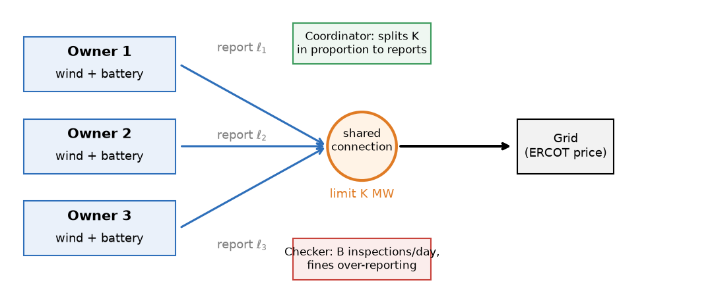
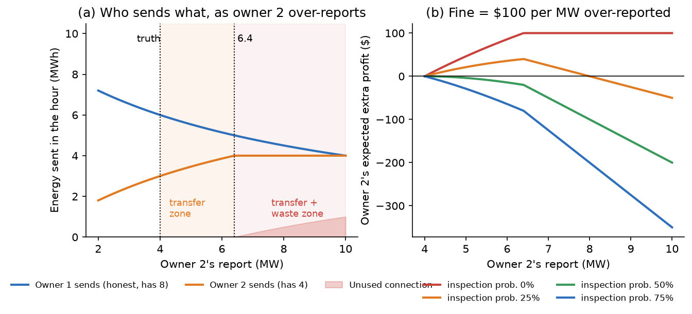
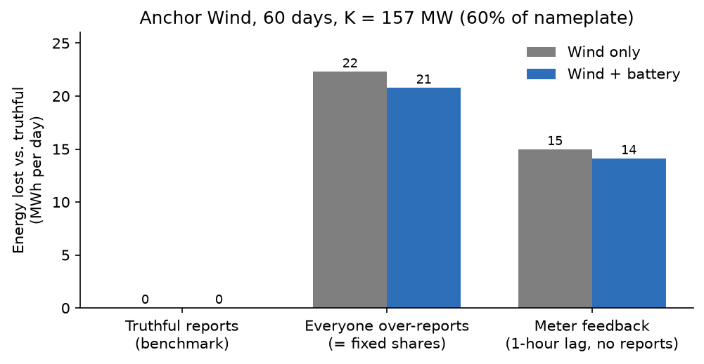
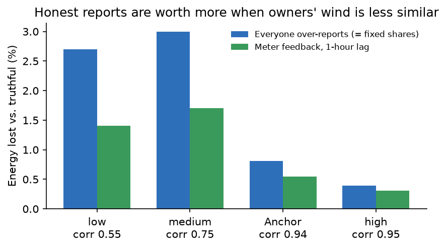
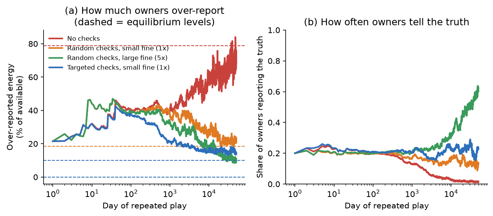
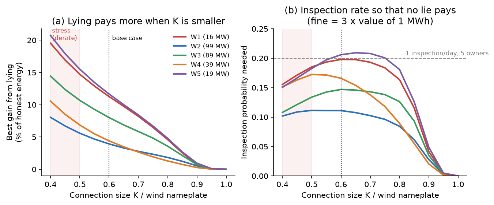

*Offline materials:* `START HERE.md` (reading plan), `sources/` (12 papers and official documents, with a reading guide), `toys/` (5 small scripts), `Decision Log.md` (who suggested what).

**Setup**

1. Several wind–battery owners share **one grid connection** that can be smaller than what they can produce together.
2. Each hour, every owner **reports** how much power it can send. The throughput is then split **proportionally to the reported capacity/supply**.
3. Reports cannot be checked from the meter alone, so owners have an incentive to **over-report** and take power from the others (from a bigger share).
4. An **inspector** with a constrained inspection capacity (e.g., a few inspections per day) can fine those generators that miss-report/lie. We study when lying pays, how owners learn to lie, which checks stop it, and which sharing rule works best.
	- All numbers below come from small examples and from **60 days of real ERCOT wind data** (Anchor Wind, 5 units). Code: `sims/simplified_sims.py`.

---

## Outline

- Section 1: The setting in plain words (+ a driagram example).
- Section 2: Why the setting is realistic, what is assumed, and what the literature says.
- Section 3: The research questions we answer.
- Section 4: The model, step by step, with every assumption listed.
- Section 5: Simple small examples (solvable "by hand")
- Section 6: Some results on real dataset 
- Section 7: The current storyline, and which results answer which question (or not)
- Section 8: Conclusions and limitations
- Section 9: Plan to execute to December 10
- Section 10: Glossary
- Appendix: Battery-timing example (the decision log and reproduction steps are in `Decision Log.md`)

---

## 1. Setup diagram

- **Owners.** $N$ companies each own a wind farm with a battery. All of them are connected to the grid through **one shared connection** (substation and line).
- **The connection limit.** The connection can carry at most $K$ MW. In windy hours the owners together could send more than $K$. Then someone must send less. This is called **curtailment**.
- **Reports.** At the start of each hour, each owner tells a coordinator how much power it can send in that hour. We call this number its **report**.
- **Sharing rule.** If the reports add up to more than $K$, the coordinator gives each owner a share of $K$ in proportion to its report. This is the **pro-rata** rule.
- **The problem.** The coordinator cannot see how much wind each owner really has. The meter only shows what the owner actually sent. So an owner can report more than it has and get a larger share. The other owners then get less.
- **The checker.** A checker can inspect a few owners per day. An inspection reads the owner's turbine and battery records and finds the true value. If the owner over-reported, it pays a fine.

---

## 2. Why this setting is realistic

### 2.1 Facts from the real world

| Fact | Why it matters for us | Source |
|---|---|---|
| Wind and battery plants often share one connection that is **smaller** than their installed capacity. In the CAISO queue, the median wind+storage plant has 142% of its connection limit installed, and the wind alone reaches the limit in 73% of plants. | A connection limit $K$ below total capacity is normal, not exotic. | LBNL *Hybrid Power Plants 2025* (local copy in `docs/references/`) |
| CAISO applies an **aggregate capability constraint** to co-located resources: market dispatch of all resources behind one connection must stay within its limit. Before that, CAISO's example of the traditional approach split a 100 MW + 50 MW pair behind a 100 MW limit into fixed limits of 67 MW and 33 MW. | Real grid operators treat "several resources, one limit" as a problem to manage. The 67/33 split is an example of our fixed-shares rule R1. (CAISO does not use our pro-rata rule.) | `sources/01`, pp. 2–4 |
| When a wind plant is curtailed, its meter shows only the power it was **allowed** to send. The power it **could** have sent is an estimate. In ERCOT, wind units send this estimate as a telemetered **High Sustained Limit (HSL)**; "under curtailment a WGR's HSL must represent actual power generation potential". | HSL is the real-world **analog** of our report: an owner-provided number that dispatch relies on and the meter alone cannot verify. It does not show that ERCOT uses our sharing rule. | `sources/02`, pp. 43–46; `sources/03`. Our dataset's `W_avail` column is this HSL. |
| **Pro-rata curtailment** (everyone cut by the same percentage) is a standard rule for sharing a congested network. In UK schemes it is based on **rated capacity or measured output**; in Australian renewable zones, curtailment is shared pro-rata by production. Other rules: "last in, first out" and market-based rules. | Pro-rata is common and studied. **Our variant is different:** it uses **reported** available power, because during curtailment measured output does not show the curtailed potential. | `sources/04` p. 6, `sources/05` p. 4, `sources/06` p. 20 |
| Developers split one facility among several buyers ("disaggregate those projects among off-takers"), with several resources behind one point of interconnection. | Several commercial parties behind one connection is a real situation. | `sources/01`, p. 2 |

### 2.2 What we assume (and say openly)

| Item | Status |
|---|---|
| Wind available per unit and hour (5 Anchor Wind units, ERCOT, Mar–Apr 2025) | **Real data** (60 full days) |
| Prices (ERCOT West hub) | **Real data**, used only to put a dollar value on results |
| The 5 Anchor units belong to **5 different companies** | **Assumed.** In reality one company owns them. We use their real, correlated wind as a realistic example of neighbors. |
| Connection limit $K = 0.6 \times$ total wind nameplate $= 157$ MW | **Assumed** (stress level). The real Anchor connection almost never binds (observed curtailment 0.1%). With $K = 0.6$, the limit binds in 49% of hours. |
| Battery size: power = 29% of wind nameplate, 1.5 hours of energy | **Calibrated** to the real Anchor battery (71.5 MW / 113 MWh) |
| Pro-rata sharing by report, inspections, fines | **Assumed design.** A rule we test, not a rule ERCOT or CAISO applies to these owners. |

How to say it in the report: *"A stylized multi-owner facility, calibrated with real ERCOT wind data. The sharing and inspection rules are designs we test, not current market rules."*

### 2.3 What the literature says, and what is new

Details, page numbers and "matches / does not match" for each source are in `sources/README - Reading Guide.md`.

| Topic | What exists | What we add |
|---|---|---|
| Sharing a congested connection | Pro-rata, last-in-first-out and market rules, used in practice and studied (sources 04, 05, 06, 07) | A pro-rata rule based on **reports that cannot be verified from the meter**, and its weakness to lying |
| Reported available power | HSL telemetry exists, and operators screen it for data quality (02, 03) | HSL-type reports treated as **strategic** |
| Proportional sharing as a game | Well studied when bids cost money (08) or are real orders or sales (09) | **Free** reports with **fines**: inspections play the role of a price |
| Inspection and security games | Mature theory with commitment and limited budgets, usually one inspectee or one attacker (10, 11) | Several inspectees that **compete for the same connection** |
| Learning in games | EXP3 and no-regret learning (12) | Learning owners in a real-data wargame |

We did not find a study of exactly "pro-rata curtailment based on self-reported availability, with inspections". This is the gap we fill. It may also mean that the exact setting is uncommon in practice, so we present the rule as a design to test.

---

## 3. The questions

### 3.1 Main question

> **Several wind–battery owners share one grid connection. How should the connection be split each hour so that (a) little capacity is wasted and (b) no owner gains by claiming more power than it has?**

The two goals pull in opposite directions:

- **Fixed shares** (each owner always gets a fixed part of $K$, for example in proportion to its size) cannot be gamed. But when one owner has little wind, its unused share is lost.
- **Shares based on reports** use all of the connection that the owners can fill, **if the reports are true**. But owners can lie to get more, and large lies waste capacity.

### 3.2 Four sub-questions, one for each Workshop 2 requirement

| # | Course requirement | Question |
|---|---|---|
| **Q1** | Game-theoretic behavior | If the connection is split in proportion to reports, does each owner want to over-report? How much does it gain, who loses, and what happens when **all** owners do it? |
| **Q2** | Learning and adaptation | If owners learn only from their own past profits, do they discover over-reporting by themselves? Do they end where the theory predicts? |
| **Q3** | Attacks and defenses | With only a few inspections per day, what inspection rate and fine make lying not worth it? Is it better to inspect at random or to inspect suspicious owners? How do owners change the way they lie? |
| **Q4** | Alternative designs and stress | Which rule works best: fixed shares, shares by report (with or without checks), a charge for unused shares, or a **meter-feedback** rule that uses no reports at all? Does the answer change on stress days (smaller connection) or when owners' wind is less similar? |

---

## 4. The model, step by step

### 4.0 The game in one box

| Part | Definition |
|---|---|
| **Players** | $N$ owners (strategic) and one checker (commits to a rule). The coordinator and the grid follow fixed rules; they are not players. |
| **One round** | One day = 24 hours. Repeated over many days for learning. |
| **Checker's choice** (before any day) | An inspection rule: budget $B$ per day, how to pick owners (random or targeted), and the fine $f$. It is announced and kept. |
| **Owner's choice** (each day) | A report $\ell_{it} \in [0, L_i]$ for each hour. In our computations: one of 5 report options for the whole day (Section 4.8), applied each hour to its own available power. |
| **What an owner knows when it chooses** | Its own available power each hour and the checker's rule. Not the others' available power or reports. |
| **What happens each hour** | Shares by pro-rata → delivery $x = \min(a, k)$ → battery follows its fixed rule. |
| **After the day** | Inspections, then fines for inspected owners that over-reported. |
| **Owner's payoff** | $v \sum_t x_{it} - \text{fine}_i$ |
| **Checker's goal** | Few lies and little lost energy with a small budget. We **compare** checker rules; we do not optimize one checker objective. |
| **Solution concepts** | Owners: Nash equilibrium given the checker's rule. Checker: Stackelberg leader (commits first). Learning: each owner runs EXP3 over repeated days. |

### 4.1 Notation (only ten symbols)

| Symbol | Meaning | Unit |
|---|---|---|
| $i = 1,\dots,N$ | owner | - |
| $t$ | hour | - |
| $K$ | connection limit | MW |
| $L_i$ | installed export capacity of owner $i$ = wind nameplate + battery power (the largest report allowed). In the wind-only results, $L_i$ = wind nameplate. | MW |
| $a_{it}$ | **available power**: what owner $i$ can really send in hour $t$ (wind now, plus what the battery can discharge now) | MW |
| $\ell_{it}$ | **report**: what owner $i$ says it can send, $0 \le \ell_{it} \le L_i$ | MW |
| $k_{it}$ | **share** given by the coordinator | MW |
| $x_{it}$ | energy **actually sent** | MWh |
| $v$ | value of one MWh sent (market price + tax credit, assumed positive) | \$/MWh |
| $\alpha_i$, $f$ | probability that owner $i$ is inspected; fine per MWh over-reported | -, \$/MWh |

### 4.2 What happens in one hour (timing)

1. **Before the hour.** The checker has already announced its inspection rule (for example, "one owner per day, chosen at random"). Each owner knows its own available power $a_{it}$ for the hour.
2. **Reports.** Each owner sends its report $\ell_{it}$.
3. **Shares.** The coordinator computes the shares $k_{it}$ with the rule below.
4. **Delivery.** Each owner sends $x_{it} = \min(a_{it}, k_{it})$. It cannot send more than it has, and it cannot send more than its share.
5. **Battery.** Wind that could not be sent is stored if the battery has room. The rest is spilled.
6. **After the day.** The checker inspects owners according to its rule. Inspected liars pay $f \times$ (MWh over-reported).

### 4.3 Step 1: physics in one hour

- Each owner has wind $W_{it}$ and a battery with power $P_i$, energy $E_i$ and efficiency $\eta$.
- Available power = wind now + what the battery can discharge now:
  $$a_{it} = W_{it} + \min(P_i,\ \eta\, s_{it}),$$
  where $s_{it}$ is the energy stored at the start of the hour.
- The battery follows a **simple fixed rule** (not a fixed schedule): send as much as the share allows (wind first, then battery), and store wind that cannot be sent. The rule reacts to the share, but the owner does not choose it. The battery level changes only with energy **actually** charged or discharged.
- Total sent cannot exceed the connection: $\sum_i x_{it} \le K$.

*Why a fixed battery rule:* it keeps one clear meaning for "available power" (wind now + the most the battery can discharge now). Optimizing the battery strategically is an extension (Appendix A). Workshop 1 showed it changes total value by only about 0.24%.

### 4.4 Step 2: what exactly is reported

The report is a **commitment**: *"In this hour I can send up to $\ell_{it}$ MW, and I will send it if I get it."*

- The truth is $a_{it}$. **Over-reporting** means $\ell_{it} > a_{it}$.
- The report is capped at installed capacity, $\ell_{it} \le L_i$. The coordinator can enforce this cap because $L_i$ is public.
- What the meter shows: only $x_{it}$. If $x_{it} < k_{it}$, the owner left part of its share unused. That is visible.
- What the meter does **not** show: whether an owner that used its whole share could have sent more.

### 4.4a Who knows what

- **Common knowledge:** $N$, $K$, each $L_i$, $v$, the sharing rule, and the checker's rule ($B$, $f$, whom to inspect).
- **Each owner** knows its own $a_{it}$, $\ell_{it}$, $k_{it}$ and $x_{it}$, but does not directly observe the other owners' values.
- **The checker** sees all reports, shares and deliveries (we assume a meter per owner), plus a noisy estimate $\hat a_{it}$. It learns $a_{it}$ only by inspecting.
- **What an owner can infer.** From its own share it sees the common scaling factor $\rho_t = k_{it}/\ell_{it}$ (if $\ell_{it}>0$). If $\rho_t<1$, the limit binds and $\sum_j \ell_{jt} = K/\rho_t$, so it learns the others' **total** report $K/\rho_t - \ell_{it}$, not who reported what (with $N=2$, this is the other owner's report). If $\rho_t=1$, it learns only $\sum_j \ell_{jt} \le K$.

### 4.5 Step 3: the sharing rule (pro-rata)

$$k_{it} = \ell_{it} \times \min\left(1,\ \frac{K}{\sum_j \ell_{jt}}\right).$$

In words: if the reports fit in $K$, everyone gets what it asked for. If not, everyone is scaled down by the **same percentage**.

### 4.6 Step 4: profit

$$\text{profit}_i = v \sum_t x_{it} \;-\; \text{fine}_i.$$

We count energy in MWh and use one common value $v$ per MWh. So "profit" is "energy sent minus fines measured in MWh". A fine of "$3\times$" means 3 times the value of one MWh, per MWh over-reported.

### 4.7 Step 5: the checker

- **Budget:** $B = 1$ inspection per day for $N = 5$ owners.
- **Inspection:** reads one owner's records for one day. It finds the true $a_{it}$ exactly (baseline).
- **Fine:** $f$ per MWh over-reported in that day.
- **Commitment:** the checker announces its rule in advance and follows it. Owners choose their reports knowing the rule. This is a **Stackelberg** setup: the checker leads, the owners follow.
- **Two rules for choosing whom to inspect:**
  - *Random:* each owner has probability $1/5 = 20\%$ of being inspected each day.
  - *Targeted:* the checker has its own noisy estimate $\hat a_{it}$ of each owner's available power. Each day it inspects the owner with the largest gap "reports minus estimate", summed over the day and divided by the owner's nameplate. In the code, $\hat a_{it}$ is the high sustained limit (HSL) in the unit's Current Operating Plan (COP). For a wind unit, ERCOT updates the COP HSL with its own short-term wind forecast, and the owner's scheduler may only override it with a lower value. For a battery, the checker could also use the state-of-charge telemetry sent to ERCOT, although state of charge alone does not determine available power. Its error has a standard deviation of 16% of nameplate (printed by the script). We use it only to give the estimate a realistic error size.
- **Is this realistic?** Real operators already screen HSL-type numbers: they compare HSL with metered output when the plant is not curtailed, and they plot it against wind speed and the power curve (`sources/02` pp. 43–46, `sources/03` p. 15). ERCOT also makes its own wind forecast from site and met-tower data (`sources/02` pp. 7–8). These are **imperfect screens**: a forecast is not a measurement. The fine, and the assumption that an inspection always finds the truth, are ours.

### 4.8 Step 6: learning owners

- Each owner chooses one of **5 report options** per day:
  1. *truth* ($\ell = a$);
  2. *×1.25* ($\ell = \min(1.25a, L)$);
  3. *×1.5* ($\ell = \min(1.5a, L)$);
  4. *cap* ($\ell = L$ every hour);
  5. *cap when windy* ($\ell = L$ only when its own wind is above half of nameplate, truth otherwise).
- Each owner uses **EXP3**, a standard no-regret learning rule. It sees only its own profit from the option it played. It does not need to know the sharing rule or what the others do.
- Each "day" of play is one real day drawn at random from the 60 days.

### 4.9 Step 7: the rules we compare (Q4)

| Rule | How shares are set | Needs reports? | Can be gamed by false reports? |
|---|---|---|---|
| **R0 Truthful benchmark** | pro-rata on true $a$ | (truth assumed) | - |
| **R1 Fixed shares** | $k_i = K L_i / \sum_j L_j$, always (like CAISO's 67/33 example, Section 2.1) | No | No |
| **R2 Pro-rata, no checks** | pro-rata on reports | Yes | Yes |
| **R3 Pro-rata + random checks** | R2 + random inspections | Yes | Less |
| **R4 Pro-rata + targeted checks** | R2 + inspections of suspicious owners | Yes | Less |
| **R5 Charge for unused share** | R2 + a charge on $k_i - x_i$, read from the meter | Yes | Less |
| **R6 Meter feedback** | Start from fixed shares. An owner that left part of its share unused last hour is capped at what it sent plus a margin (10% of its nameplate); its leftover goes to the others. | **No** | No |

R6 is our strongest "no-trust" rival. It needs no reports, but it reacts one hour late. Two cautions:

- **It depends on wind persisting from hour to hour.** In `toys/toy03`, with persistent wind it loses about 4% where fixed shares lose 19%. With no persistence it loses **more** than fixed shares. This is a toy result, not a general law.
- **It may be gamed in other ways.** "No" in the last column means only that false **reports** cannot game it. Allocation based on past sales ("turn-and-earn") makes buyers inflate sales to earn future allocations (`sources/09`). By analogy, an owner might discharge its battery just to keep a large share. This is plausible but not tested.

### 4.10 Step 8: what we measure

| Metric | Meaning |
|---|---|
| **Energy sent** | total MWh through the connection (higher is better) |
| **Lost energy** | energy below the truthful benchmark R0 (= wasted connection) |
| **Transfer** | energy moved from one owner to another, compared with R0 |
| **Over-reporting** | MWh reported above the truth, as a % of available energy |
| **Checks** | share of lies caught, fines paid, inspections used |

We keep these separate. Lost energy lowers the total. A transfer does not change the total; it only moves energy from one owner to another.

### 4.11 All assumptions in one list

| # | Assumption | Why it is acceptable | What changes if it is wrong |
|---|---|---|---|
| A1 | One hour is one decision period | Our data are hourly | Real controllers act in seconds; R6 would likely get better (not tested) |
| A2 | Owners are price-takers; one MWh is worth $v > 0$ to its owner | Small plants; wind often gets tax credits, so it keeps producing at low or negative prices | In 38% of congested hours of our window the real-time price was negative. If the **net** value (price + credits) is negative, owners want to send less, and the reason to over-report disappears in those hours. |
| A3 | Owners know their own $a_{it}$ for the hour | Hour-ahead wind is fairly predictable | Honest forecast errors look like lies; the checker must allow a tolerance |
| A4 | Battery follows a fixed simple rule | Keeps "available power" well defined | Strategic battery timing is a second game (Appendix A) |
| A5 | Report cap = installed capacity $L_i$ | $L_i$ is public | Without a cap, reports would grow without limit |
| A6 | Inspection finds the truth exactly | Turbine and battery records exist | Imperfect inspection = smaller effective fine (extension) |
| A7 | Fines are set by contract | Shared-facility agreements can include penalties | Real penalties may be smaller or slower |
| A8 | The checker commits to its rule | Standard for inspection games; announced audit policies are common | Without commitment, the checker may not inspect after the fact, and owners know it |
| A9 | Owners do not collude | Simplest case | Collusion is a stress test (extension) |
| A10 | 5 Anchor units = 5 owners | Real, correlated neighbors | Owners with less similar wind change the numbers (Section 6.2) |

---

## 5. The smallest examples (by hand)

### 5.1 Example B: two owners, one hour

Owner 1 has $a_1 = 8$ MW, owner 2 has $a_2 = 4$ MW, the connection is $K = 9$ MW, and $v = \$100$/MWh. Both can report at most 10 MW. Owner 1 reports the truth.

| Owner 2 reports | Owner 1 sends | Owner 2 sends | Unused connection |
|---|---|---|---|
| 4 (truth) | 6.0 | 3.0 | 0 |
| 6.4 | 5.0 | 4.0 | 0 |
| 8 | 4.5 | 4.0 | 0.5 |
| 10 | 4.0 | 4.0 | 1.0 |

*Figure 2. (a) As owner 2 raises its report, it takes energy from owner 1. Up to 6.4 MW, this is a pure transfer. Above 6.4 MW, owner 2 gets a share it cannot fill, and part of the connection is wasted. (b) Owner 2's extra profit when each MW over-reported costs \$100 if inspected. At a 50% inspection probability, no lie pays.*

**Three lessons:**

1. **Lying pays.** Owner 2 gains up to 1 MWh (\$100), all taken from owner 1.
2. **A moderate lie is a transfer; a large lie also wastes capacity.**
3. **The best lie is invisible to the meter.** At a report of 6.4, owner 2 sends exactly its share. The meter shows nothing unusual. Only an inspection of its records can reveal the lie.

### 5.2 What happens when both owners can lie (equilibrium)

We checked every pair of reports on a 0.1 MW grid (see code).

- **Truth is not an equilibrium.** Owner 2 always wants to report more.
- **In every equilibrium, owner 1 reports its cap (10 MW) and owner 2 reports between 8 and 10 MW.** Owner 2 always gets its full 4 MW. Owner 1 gets 4.5 to 5 MW instead of 6. Up to 0.5 MW of the connection is wasted.

**General result (simple to prove):** a larger report never lowers your own share. So, with no checks, **reporting the cap is always a best choice** (weakly dominant), and "everyone reports the cap" is always an equilibrium. There can be other equilibria, because an owner that already gets all it can send does not care about its report.

**Consequence:** if everyone reports the cap, shares are proportional to installed capacity. **This is the same as fixed shares (R1).** Without checks, the report-based rule loses the very advantage it was designed to have.

**Why this differs from the classic proportional-sharing game** (Johari & Tsitsiklis, `sources/08`): there, users **pay** for their bids, so bidding more has a cost. Our reports are **free**, so without checks the cap is weakly dominant. An expected fine plays a role similar to a price, but it is paid only when caught, and only on the false part of the report.

### 5.3 The "lying does not pay" rule

Suppose the others report the truth and the connection is congested, with total available power $Q = \sum_j a_j > K$. If owner $i$ over-reports by $d$ MW, its share grows by

$$G(d) = \frac{K\,(Q - a_i)\, d}{Q\,(Q + d)} \quad \text{MWh},$$

until its share reaches $a_i$. After that, the gain stays flat. This gain grows quickly at first and then flattens (it is concave). The expected fine grows in a straight line: $\alpha_i f d$. So **no lie pays if and only if the first small step of lying does not pay**:

$$\boxed{\ \alpha_i \, f \;\ge\; v\,\frac{K\,(Q - a_i)}{Q^2}\ }$$

*(inspection probability × fine per MWh ≥ value of the extra energy from the first small step of lying)*

A numerical check (`toys/toy02`) agrees with this rule in 3,000 of 3,000 random cases. This is a check on a grid, not a proof; the proof is the concavity argument above.

This holds when the connection is congested ($Q > K$), the others' reports are fixed, and the inspection probability does not depend on the report. If the others report $\ell_j$ instead of the truth, replace $Q - a_i$ by $S = \sum_{j \ne i} \ell_j$ and $Q$ by $a_i + S$.

Example B: $v K (Q - a_2)/Q^2 = 100 \times 9 \times 8 / 144 = \$50$ per MW. With a fine of \$100 per MW over-reported, the checker needs $\alpha \ge 50\%$ (Figure 2b).

**Two warnings about this rule:**

- It holds **hour by hour**, and an owner can choose **when** to lie. So it must hold in the hour where lying pays most. On our real data, each MW of lying (the first small step) is worth on average 0.4–0.7 MWh in congested hours, but up to **0.96 MWh** for the small owners in the best hours. With one random inspection per day ($\alpha = 20\%$), the fine must be about **5×** the value of one MWh to stop even a careful liar. This matches the equilibrium results in Section 6.3.
- If the others lie, the numbers in the rule change (use $S$ as above). The equilibrium tables in Section 6.3 handle this case by computation.

---

## 6. First results on real data

Setup for all results: 5 Anchor Wind units (16, 99, 89, 39, 19 MW; 262 MW total), 60 full days (Mar–Apr 2025), $K = 157$ MW. The connection binds in 49% of hours.

> **Scope note.** Figure 3 includes batteries. All **game** results (the tables in 6.1, and Sections 6.2–6.5) are **wind only**. Figure 3 shows batteries change the losses only a little, so we expect the same picture with batteries, but this must be checked. Building the battery version of the reporting game is the first task in Section 9.

### 6.1 How much does lying cost? (Q1, Q4)

*Figure 3. Energy lost per day compared with truthful reports. If everyone over-reports to the cap, the result equals fixed shares and loses 22 MWh/day (0.8%). The meter-feedback rule needs no reports and loses 15 MWh/day (0.5%). Batteries reduce both losses slightly.*

**Lost energy is small here, but transfers are large.** When everyone reports the cap, some owners gain and others lose about 4–5% of their energy:

| Unit | Change vs. truthful when everyone reports the cap |
|---|---|
| W1 (16 MW) | +3.5% |
| W2 (99 MW) | **−4.0%** |
| W3 (89 MW) | +3.3% |
| W4 (39 MW) | **−4.6%** |
| W5 (19 MW) | +4.9% |

**A single liar** (reports its cap every hour, the others are truthful) gains 4–12% of its own energy. The others lose about **twice** what the liar gains, and the difference is wasted capacity:

| Liar | Liar gains | Others lose | Wasted |
|---|---|---|---|
| W1 (16 MW) | +17 MWh/day (+11%) | −31 | 13 |
| W3 (89 MW) | +69 MWh/day (+8%) | −141 | 72 |
| W5 (19 MW) | +20 MWh/day (+12%) | −40 | 20 |

For scale: at the average positive real-time price in our window (about \$33/MWh), W3's gain of 69 MWh/day is about \$2,300 per day.

### 6.2 When are honest reports worth more? (Q4)

*Figure 6. Energy lost by fixed shares (= everyone lies) and by meter feedback, for owner groups whose wind is more or less similar. Groups are from the repository's `agent_sets.csv`.*

The Anchor units are very similar (correlation 0.94): when one has wind, all have wind. Then fixed shares waste little. When owners' wind is less similar (correlation 0.55–0.75), fixed shares lose about **3%** (2.7–3.0%), three to four times more. **Honest reports matter most when owners are different.** That is exactly when the report rule is worth protecting with checks.

### 6.3 Which checks stop lying? (Q1, Q3, Q4)

We computed **all** pure Nash equilibria of the game with 5 owners and the 5 report options of Section 4.8 ($5^5 = 3125$ combinations, 60 real days):

| Design | Equilibrium reports | Over-reporting | Energy (MWh/day) |
|---|---|---|---|
| R0 Truthful benchmark | - | 0% | 2760 |
| R2 No checks | all owners: **cap** | 79% | 2737 |
| R3 Random checks, fine 1× | all owners: **cap when windy** | 19% | 2733 |
| R3 Random checks, fine 5× | all owners: **truth** | 0% | 2760 |
| R4 Targeted checks, fine 1× | **truth**, or ×1.25 by four owners | 0% or 10% | 2760 or 2751 |
| R5 Charge 1× for unused share (meter only) | four owners: **cap when windy**, one: truth | 11% | 2723 |

What this says, in words:

- **No checks:** everyone lies as much as allowed. This confirms Section 5.2 on real data.
- **Weak random checks do not stop lying. They change how owners lie.** Owners lie only in windy hours, when lying pays most and the fine is smallest.
- **Strong random checks** (one inspection per day, fine 5×) make the truth the only equilibrium.
- **Targeted checks** can reach the truth even with a **small** fine, because big liars are almost always caught. But there is a second equilibrium with **small lies** (×1.25) that hide inside the checker's estimation error.
- **A meter-only charge** does not stop the smart lie (Section 5.1, lesson 3). It even lowers total energy here.

### 6.4 Do learning owners find these equilibria? (Q2)

*Figure 5. Owners learning with EXP3 from their own profit only (6 runs, 50,000 simulated days, log scale; the average over the last 5,000 days is reported below). Dashed lines are the equilibrium levels from Section 6.3. Targeted checks have two equilibria (0% and 10%).*

| Design | Over-reporting at the end of learning | Equilibrium level (Section 6.3) | What the learners do |
|---|---|---|---|
| No checks | 71% | 79% | Lie a lot (×1.5 and cap); almost never truthful (1%) |
| Random checks, fine 1× | 22% | 19% | Mix several lies; truthful 12% of the time |
| Random checks, fine 5× | 10% | 0% | Move toward the truth: truthful 60% of the time, still rising |
| Targeted checks, fine 1× | 14% | 0% or 10% | **Settle near the small-lie equilibrium**: four owners mostly play ×1.25; W2 is mostly truthful |

- **Owners learn to lie by themselves.** Without checks, over-reporting rises from 40% (random start) to 71%. No one has to "teach" them.
- **In our runs, learners ended near the bad equilibrium.** With targeted checks, the truthful equilibrium exists, but learners ended near the other one: small lies that hide inside the checker's estimation error. This is a warning for the checker's design.
- **Learning is slow and noisy.** It takes tens of thousands of simulated days, because the gain from lying is only a few percent and daily wind changes are large. Learners keep mixing options and do not fully reach an equilibrium. So we do not claim that learning always converges. The equilibria in Section 6.3 describe owners who know the rule; the learning curves describe owners who only see their own profit.

### 6.5 Stress days: a smaller connection (Q4)

*Figure 4. (a) The best gain from lying (best of 10 lie types, others truthful), as the connection gets smaller. (b) The inspection probability that makes every one of these lies unprofitable, with a fine of 3× the value of one MWh.*

- **Lying pays more on stress days.** If the connection drops from 60% to 40% of nameplate (for example, a line problem), the small owners' best gain rises from about 11% to about 20% of their energy. So the **damage if the checker fails** (or is switched off) is larger on stress days.
- **But the needed inspection rate does not rise.** With a fine of 3×, it stays between 10% and 21% for all connection sizes, and it even falls a little for the small owners when the connection is very tight. The reason: on stress days the profitable lies are also larger, and the fine grows with the size of the lie.
- In the base case, one inspection per day (20%) is **slightly short** for the smallest owner, W5 (21% needed), against these 10 lie types. A careful liar who lies only a little and only in the best hours needs more (Section 5.3: a fine of about 5× at 20%).
- **Small owners are the most tempted.** The gain from the first small step of lying, $K(Q - a_i)/Q^2$, is largest when $a_i$ is small. And because their own energy is small, the same extra MWh is a larger percentage gain for them.

---

## 7. The storyline: which result answers which question

| Question | Answer so far | Evidence | Status |
|---|---|---|---|
| **Q1** Does pro-rata invite lying? | Yes. With no checks, reporting the cap is always a best choice. The result equals fixed shares. | Sections 5.2, 6.3 | Proven (simple) + confirmed on data |
| **Q1** Who pays? | Honest owners. One liar takes 4–12% more energy; the others lose about twice that; the difference is wasted. | Section 6.1 | Real data |
| **Q2** Do learning owners find it? | Yes, they learn to lie without being told. Their over-reporting moves toward the equilibrium levels, but slowly and with a lot of mixing. With targeted checks, in our runs, they ended near the **small-lie** equilibrium, not the truthful one. | Section 6.4 | Simulated, 6 runs, wind only |
| **Q3** What stops lying? | Random checks need a large enough fine (rule in Section 5.3). Weak checks only change **when** owners lie. Targeted checks can work with smaller fines, but they allow small hidden lies, which learners found in our runs. | Sections 5.3, 6.3, 6.4 | Real data, 5 report options, wind only |
| **Q4** Which rule is best? | If owners' wind is similar, fixed shares or meter feedback lose under 1%, and reports add little. If owners differ, honest reports save about 3%, so a report rule **with checks** is worth it. Meter feedback is a strong no-trust option. | Sections 6.1, 6.2 | Real data, hourly steps |
| **Q4** Stress? | A smaller connection makes lying more profitable, so more is at stake if the checker fails. The needed inspection **rate** stays about the same. | Section 6.5 | Real data, wind only |

**One-paragraph story for the final report:**

*Sharing a connection in proportion to reported power uses the connection well, but only if owners tell the truth. The meter cannot verify reports, so every owner has a reason to over-report. When all owners do it, the rule falls back to fixed shares. Learning owners discover over-reporting on their own. Inspections with a pre-announced rule and a large enough fine restore honest reports. Weak inspections only make lying smarter, and targeted inspections leave room for small hidden lies, which learning owners find. Whether all this matters depends on how different the owners are. When their wind is similar, simple fixed shares or meter feedback are almost as good. When it differs, honest reports are worth protecting. On stress days the temptation and the damage grow, even though the inspection rate needed stays about the same.*

---

## 8. What we do not claim

- We do **not** claim that the Anchor units are separate companies, or that ERCOT uses our sharing or inspection rules.
- The game results (Sections 6.1 tables, 6.2–6.5) are **wind only**. Only Figure 3 includes batteries.
- Learning results come from one learning rule (EXP3) with a fixed exploration rate. We do not claim that learning always reaches an equilibrium.
- Our energy numbers assume every MWh has the same positive value (A2). Dollar figures are rough scale only.
- The battery follows a simple fixed rule. We do not study strategic battery timing in the main game (Appendix A).
- The equilibrium analysis uses **5 report options**, not every possible report. Section 5.2 covers continuous reports for two owners.
- Meter feedback is modeled with a one-hour delay. Real controllers are faster, so R6 may be even better than shown. If so, we will say it.
- The checker's estimate uses the real COP forecast error as a stand-in for an independent estimate. We did not check whether this error is right for each owner, hour, and curtailment condition. A real checker might have better or worse data.

---

## 9. Plan to December 10

| Dates | Work | Output |
|---|---|---|
| Nov 20–23 | Team agrees on Sections 3–4. Move `sims/simplified_sims.py` logic into the main package with tests (Examples A and B as unit tests). **First priority: the battery version of the reporting game** (report cap = wind + battery power, battery level updated from actual delivery), then re-run Sections 6.3–6.5. | Agreed spec v1.0; one consistent wind–battery game |
| Nov 24–29 | Q1/Q3: finer report grid; random vs. targeted checks with a budget sweep (B = 0, 1, 2) and a fine sweep. Add honest forecast error (A3) with a tolerance band. | Equilibrium tables, figures |
| Nov 30–Dec 2 | Q2: learning owners **and** a learning checker (it learns whom to inspect from past catches). Several seeds. | Learning figures |
| Dec 3 | Exam (no project work) | - |
| Dec 4–7 | Q4: all rules on the three correlation sets and on stress days (K drops for a few hours; two owners collude). | Final comparison table |
| Dec 8–9 | Report and slides | Workshop 2 |

**Suggested split (by question, so each person owns one result):**

| Role | Owns | Main output |
|---|---|---|
| Physics and rules | Data, battery rule, rules R0–R6, Q4 | Figures 3, 4, 6 |
| Game theory | Equilibria, the "lying does not pay" rule, Q1 and Q3 theory | Section 5, table in 6.3 |
| Learning and security | Learning owners, learning checker, attacks (timing lies, collusion), Q2 and Q3 simulations | Figure 5, attack table |

The game definition (Section 4) belongs to everyone. Any change to it must be written here first.

---

## 10. Glossary

| Term | Meaning in this project |
|---|---|
| Available power $a_{it}$ | What an owner can really send in an hour (wind + what the battery can discharge now) |
| Report $\ell_{it}$ | What an owner says it can send |
| Share $k_{it}$ | What the coordinator lets it send |
| Pro-rata | Everyone scaled down by the same percentage |
| Over-reporting | Report above available power |
| Transfer | Energy that moves from one owner to another because of a lie |
| Wasted (lost) energy | Connection capacity left unused that honest reports would have filled |
| Best response | The report that gives an owner the most profit, given the others' reports |
| Nash equilibrium | Reports such that no owner can gain by changing only its own report |
| Weakly dominant | A choice that is never worse than any other, whatever the others do |
| Stackelberg / commitment | The checker announces its rule first; the owners then respond |
| "Lying does not pay" | Inspection probability × fine ≥ value of the first small step of lying (Section 5.3) |
| EXP3 | A learning rule that tries options, keeps score of its own profits, and plays good options more often |
| Meter feedback | A rule that sets shares from what owners actually sent last hour, without reports |
| HSL | High Sustained Limit: the power a plant says it could produce now (real ERCOT/CAISO telemetry) |
| Old word: deterrence | Now "lying does not pay" |
| Old words: capability, headroom | Now "available power" $a_{it}$ and "share" $k_{it}$ |
| Old word: strategic inefficiency | Now "lost energy" and "transfer" |

---

## Appendix A. Example A: battery timing (from Workshop 1)

Two owners, two hours, connection 1 MW, prices \$20 then \$100, battery wear \$5 per MWh discharged, perfect efficiency. Each owner has 1 MWh of wind in hour 1 and can sell it now or store it for hour 2.

| | Owner 2: store | Owner 2: sell now |
|---|---|---|
| **Owner 1: store** | (47.5, 47.5) | (95, 20) |
| **Owner 1: sell now** | (20, 95) | (10, 10) |

Storing is best for each owner whatever the other does, so both store. They then share 1 MW in hour 2 and earn \$95 in total, instead of \$115 if one sold early. (Checked numerically in the code.)

**Why this is not the headline:** on real data, owners scheduling their batteries alone lose only about 0.24% compared with a central planner (Workshop 1 results). The reporting problem moves 4–12% of an owner's energy. Battery timing stays as an extension: an owner could also time its battery to make lying easier.

## Appendix B. Decision log and reproduction

See `Decision Log.md` (who suggested each choice, what we decided) and `START HERE.md`.
