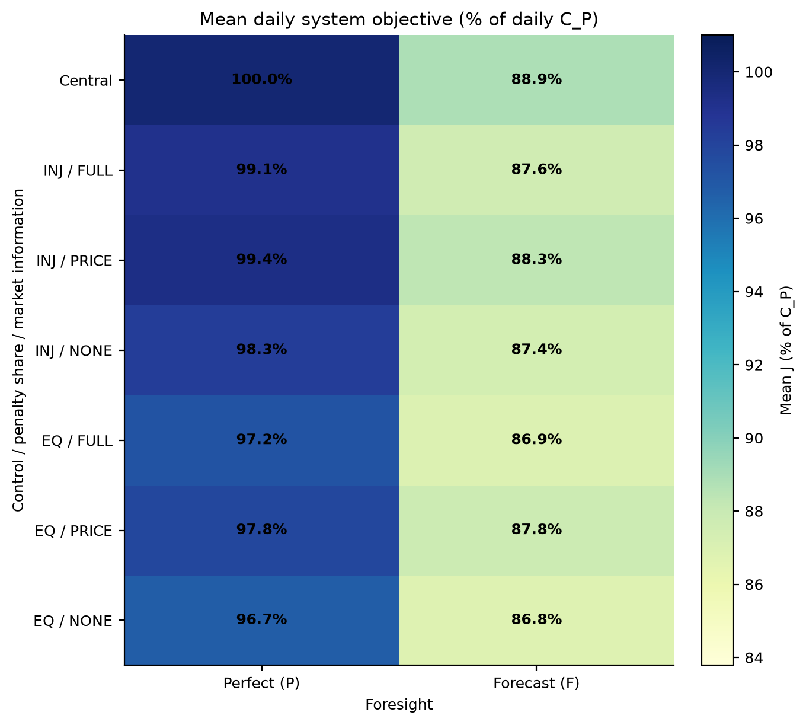
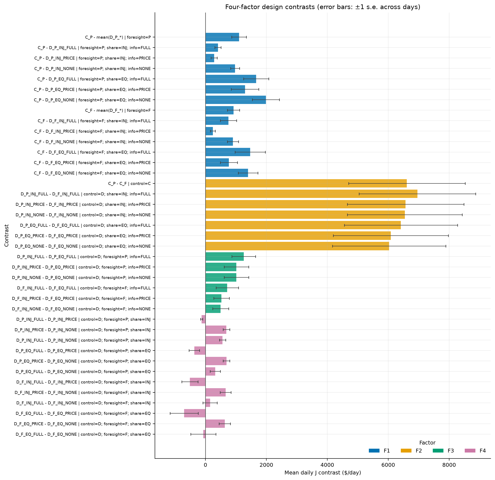
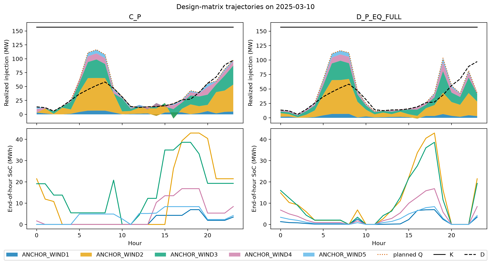
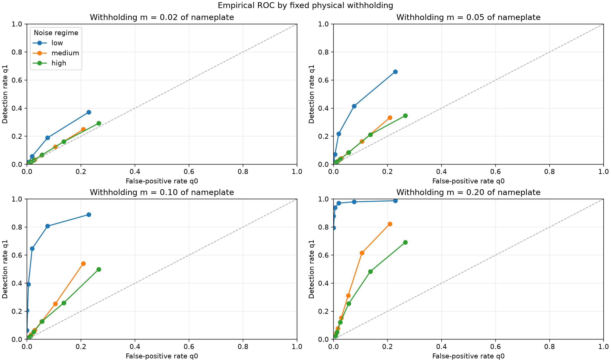

# Workshop 1 Report: Strategic Coordination in Co-Located Wind-Storage Systems

Team: Nicolás Acevedo Villena, Subham Saha, and Ziqi Wei
Course: MIT 6.974 Wargame, Fall 2026

## 1. Scope

Part I asks how much realized system value is lost when co-located wind-storage units sharing one point of interconnection (POI) are operated by independent decision makers, and which of four design factors has the largest effect on realized system value. The main experiment is the 14-cell design matrix. A preliminary monitor calibration serves as a Part III input.

### Model

Each unit chooses wind curtailment, battery charge, and battery discharge subject to battery power, energy, efficiency, and terminal-state constraints. Net injections share a POI limit K and a delivery obligation D. The planning mechanisms allocate shortfall and attempted-overflow penalties, after which a realization layer removes any physical overflow pro rata. The realized system objective is `J = realized energy profit - discharge degradation cost - lambda_minus × realized under-delivery`; attempted-overflow penalties are strategic signals and do not enter J. [DESIGN.md](../DESIGN.md) gives the full implementation contract, and [two_player_formulation.md](../two_player_formulation.md) gives the minimal analytical version.

## 2. Data

| Quantity | Source | Window | Status |
| --- | --- | --- | --- |
| DA and RT prices | ERCOT NP4-180-ER and NP6-785-ER | 2025-03-01 to 2025-04-30 | observed |
| Wind availability and output | ERCOT NP3-965-ER | 2025-03-01 to 2025-04-30 | observed |
| COP forecast and baseline | ERCOT COP snapshot and NP3-966-ER | 2025-03-01 to 2025-04-30 | observed/constructed |
| Forecast-error regimes | ERCOT NP4-732-CD and NP4-742-CD | October 2026 system snapshot; March-April 2025 resource sample | calibrated |
| Battery design | Observed Anchor BESS, EIA-860, and NREL ATB | base configuration | calibrated |
| POI, obligation, penalties, and four factors | wargame design | 60 complete operating days | designed |

The configured window contains 60 complete 24-hour episodes and 1 incomplete episode(s) across 61 calendar days. The design matrix evaluates 60 days at HB_WEST for the Anchor Wind base site.

| Resource | Nameplate (MW) | Coverage | Mean capacity factor |
| --- | --- | --- | --- |
| ANCHOR_WIND1 | 16.0 | 100.0% | 0.507 |
| ANCHOR_WIND2 | 98.8 | 100.0% | 0.601 |
| ANCHOR_WIND3 | 88.8 | 100.0% | 0.516 |
| ANCHOR_WIND4 | 38.7 | 100.0% | 0.585 |
| ANCHOR_WIND5 | 19.3 | 100.0% | 0.485 |

The system-level monitor-noise snapshot is from a different period than the operating experiment.

## 3. Design factors and cells

| Factor | Levels | Operational meaning | Model implementation | Measured contrast |
| --- | --- | --- | --- | --- |
| F1 control | C, D | One plant controller or independent unit controllers | Central receding-horizon LP or decentralized policy | C_x minus D_x_* at fixed foresight |
| F2 foresight | P, F | Realized future conditions or operational forecasts | True wind/RT price or current truth followed by COP wind/DA price | X_P minus X_F for every matching cell |
| F3 penalty allocation | INJ, EQ | Causal contribution or equal responsibility | Positive-injection overflow shares plus own deficits, or equal system-penalty shares | INJ minus EQ at fixed F2 and F4 |
| F4 market information | FULL, PRICE, NONE | Other plans, a congestion price, or neither | Best-response game, coordinator price iteration, or fixed capacity-share POI budget | FULL minus PRICE, PRICE minus NONE, and FULL minus NONE at fixed F2 and F3 |

| F2 | Central | INJ/FULL | INJ/PRICE | INJ/NONE | EQ/FULL | EQ/PRICE | EQ/NONE |
| --- | --- | --- | --- | --- | --- | --- | --- |
| P | C_P | D_P_INJ_FULL | D_P_INJ_PRICE | D_P_INJ_NONE | D_P_EQ_FULL | D_P_EQ_PRICE | D_P_EQ_NONE |
| F | C_F | D_F_INJ_FULL | D_F_INJ_PRICE | D_F_INJ_NONE | D_F_EQ_FULL | D_F_EQ_PRICE | D_F_EQ_NONE |

Cell ids and order are defined in `code/wargame/experiments/design.py`. Every policy replans hourly over the remaining horizon, submits one hour, passes the joint action through the realization layer, and uses realized state of charge in the next hour.

## 4. Results by factor

All factor effects are matched daily contrasts on realized J from `design_matrix_effects.csv`. Percentages of C_P, including the mean max_gain percentages, are means of daily percentages; the maximum max_gain percentage is the maximum daily percentage. Solver reliability is listed beside every contrast involving FULL or PRICE. For FULL, max_gain is the remaining unilateral-deviation gain; PRICE has no unilateral-deviation statistic. Because C_P is negative on some individual days, a signed daily max_gain/C_P ratio can make the mean percentage negative even though max_gain itself is nonnegative.

### F1 control

Hypothesis: centralized control weakly increases J because it internalizes the shared POI and obligation. Central minus decentralized J is positive in 12 of 12 held-fixed cells. The perfect-foresight contrast, C_P minus the mean of its six decentralized matches, is $1,101/day (1.9% of C_P).

| Contrast on realized J | Held fixed | Mean ($/day) | Median ($/day) | Mean (% of C_P) | n days | Solver reliability for FULL/PRICE cells |
| --- | --- | --- | --- | --- | --- | --- |
| C_P - mean(D_P_*) | foresight=P | 1,101 | 473 | 1.923 | 60 | D_P_INJ_FULL: game converged 99.9% of hours, 2.11 mean sweeps/hour; max_gain distribution: mean $0.12, max $1.27; daily max_gain/C_P distribution: mean 0.000%, max 0.002%; D_P_INJ_PRICE: price coordination converged 98.3% of hours, 18.82 mean iterations/hour; max_gain is not applicable to PRICE; D_P_EQ_FULL: game converged 99.4% of hours, 1.58 mean sweeps/hour; max_gain distribution: mean $0.48, max $12.39; daily max_gain/C_P distribution: mean -0.004%, max 0.001%; D_P_EQ_PRICE: price coordination converged 97.6% of hours, 19.43 mean iterations/hour; max_gain is not applicable to PRICE |
| C_P - D_P_INJ_FULL | foresight=P; share=INJ; info=FULL | 409 | 192 | 0.926 | 60 | D_P_INJ_FULL: game converged 99.9% of hours, 2.11 mean sweeps/hour; max_gain distribution: mean $0.12, max $1.27; daily max_gain/C_P distribution: mean 0.000%, max 0.002% |
| C_P - D_P_INJ_PRICE | foresight=P; share=INJ; info=PRICE | 283 | 55 | 0.614 | 60 | D_P_INJ_PRICE: price coordination converged 98.3% of hours, 18.82 mean iterations/hour; max_gain is not applicable to PRICE |
| C_P - D_P_INJ_NONE | foresight=P; share=INJ; info=NONE | 971 | 508 | 1.681 | 60 | not applicable |
| C_P - D_P_EQ_FULL | foresight=P; share=EQ; info=FULL | 1,664 | 264 | 2.787 | 60 | D_P_EQ_FULL: game converged 99.4% of hours, 1.58 mean sweeps/hour; max_gain distribution: mean $0.48, max $12.39; daily max_gain/C_P distribution: mean -0.004%, max 0.001% |
| C_P - D_P_EQ_PRICE | foresight=P; share=EQ; info=PRICE | 1,297 | 51 | 2.227 | 60 | D_P_EQ_PRICE: price coordination converged 97.6% of hours, 19.43 mean iterations/hour; max_gain is not applicable to PRICE |
| C_P - D_P_EQ_NONE | foresight=P; share=EQ; info=NONE | 1,985 | 726 | 3.302 | 60 | not applicable |
| C_F - mean(D_F_*) | foresight=F | 921 | 431 | 1.406 | 60 | D_F_INJ_FULL: game converged 99.8% of hours, 12.67 mean sweeps/hour; max_gain distribution: mean $0.24, max $0.43; daily max_gain/C_P distribution: mean 0.000%, max 0.004%; D_F_INJ_PRICE: price coordination converged 95.4% of hours, 23.59 mean iterations/hour; max_gain is not applicable to PRICE; D_F_EQ_FULL: game converged 98.4% of hours, 6.09 mean sweeps/hour; max_gain distribution: mean $1.30, max $8.96; daily max_gain/C_P distribution: mean 0.003%, max 0.038%; D_F_EQ_PRICE: price coordination converged 95.3% of hours, 23.66 mean iterations/hour; max_gain is not applicable to PRICE |
| C_F - D_F_INJ_FULL | foresight=F; share=INJ; info=FULL | 752 | 255 | 1.266 | 60 | D_F_INJ_FULL: game converged 99.8% of hours, 12.67 mean sweeps/hour; max_gain distribution: mean $0.24, max $0.43; daily max_gain/C_P distribution: mean 0.000%, max 0.004% |
| C_F - D_F_INJ_PRICE | foresight=F; share=INJ; info=PRICE | 241 | 39 | 0.515 | 60 | D_F_INJ_PRICE: price coordination converged 95.4% of hours, 23.59 mean iterations/hour; max_gain is not applicable to PRICE |
| C_F - D_F_INJ_NONE | foresight=F; share=INJ; info=NONE | 901 | 469 | 1.499 | 60 | not applicable |
| C_F - D_F_EQ_FULL | foresight=F; share=EQ; info=FULL | 1,468 | 377 | 1.970 | 60 | D_F_EQ_FULL: game converged 98.4% of hours, 6.09 mean sweeps/hour; max_gain distribution: mean $1.30, max $8.96; daily max_gain/C_P distribution: mean 0.003%, max 0.038% |
| C_F - D_F_EQ_PRICE | foresight=F; share=EQ; info=PRICE | 767 | 61 | 1.109 | 60 | D_F_EQ_PRICE: price coordination converged 95.3% of hours, 23.66 mean iterations/hour; max_gain is not applicable to PRICE |
| C_F - D_F_EQ_NONE | foresight=F; share=EQ; info=NONE | 1,400 | 508 | 2.078 | 60 | not applicable |

### F2 foresight

Hypothesis: perfect remaining-horizon wind and RT-price foresight weakly increases J relative to COP-wind and DA-price forecasts. Every matched P minus F mean is positive. Effects range from $6,028 to $6,956/day.

| Contrast on realized J | Held fixed | Mean ($/day) | Median ($/day) | Mean (% of C_P) | n days | Solver reliability for FULL/PRICE cells |
| --- | --- | --- | --- | --- | --- | --- |
| C_P - C_F | control=C | 6,613 | 2,142 | 11.136 | 60 | not applicable |
| D_P_INJ_FULL - D_F_INJ_FULL | control=D; share=INJ; info=FULL | 6,956 | 1,927 | 11.476 | 60 | D_P_INJ_FULL: game converged 99.9% of hours, 2.11 mean sweeps/hour; max_gain distribution: mean $0.12, max $1.27; daily max_gain/C_P distribution: mean 0.000%, max 0.002%; D_F_INJ_FULL: game converged 99.8% of hours, 12.67 mean sweeps/hour; max_gain distribution: mean $0.24, max $0.43; daily max_gain/C_P distribution: mean 0.000%, max 0.004% |
| D_P_INJ_PRICE - D_F_INJ_PRICE | control=D; share=INJ; info=PRICE | 6,571 | 1,608 | 11.036 | 60 | D_P_INJ_PRICE: price coordination converged 98.3% of hours, 18.82 mean iterations/hour; max_gain is not applicable to PRICE; D_F_INJ_PRICE: price coordination converged 95.4% of hours, 23.59 mean iterations/hour; max_gain is not applicable to PRICE |
| D_P_INJ_NONE - D_F_INJ_NONE | control=D; share=INJ; info=NONE | 6,544 | 1,443 | 10.954 | 60 | not applicable |
| D_P_EQ_FULL - D_F_EQ_FULL | control=D; share=EQ; info=FULL | 6,417 | 1,514 | 10.320 | 60 | D_P_EQ_FULL: game converged 99.4% of hours, 1.58 mean sweeps/hour; max_gain distribution: mean $0.48, max $12.39; daily max_gain/C_P distribution: mean -0.004%, max 0.001%; D_F_EQ_FULL: game converged 98.4% of hours, 6.09 mean sweeps/hour; max_gain distribution: mean $1.30, max $8.96; daily max_gain/C_P distribution: mean 0.003%, max 0.038% |
| D_P_EQ_PRICE - D_F_EQ_PRICE | control=D; share=EQ; info=PRICE | 6,083 | 1,438 | 10.018 | 60 | D_P_EQ_PRICE: price coordination converged 97.6% of hours, 19.43 mean iterations/hour; max_gain is not applicable to PRICE; D_F_EQ_PRICE: price coordination converged 95.3% of hours, 23.66 mean iterations/hour; max_gain is not applicable to PRICE |
| D_P_EQ_NONE - D_F_EQ_NONE | control=D; share=EQ; info=NONE | 6,028 | 1,253 | 9.913 | 60 | not applicable |

### F3 penalty allocation

Hypothesis: causal positive-injection overflow shares and own-deficit charges increase J relative to equal system-penalty shares. Every INJ minus EQ mean is positive, from $498 to $1,255/day. The medians show that this effect has a heavy tail.

| Contrast on realized J | Held fixed | Mean ($/day) | Median ($/day) | Mean (% of C_P) | n days | Solver reliability for FULL/PRICE cells |
| --- | --- | --- | --- | --- | --- | --- |
| D_P_INJ_FULL - D_P_EQ_FULL | control=D; foresight=P; info=FULL | 1,255 | 11 | 1.860 | 60 | D_P_INJ_FULL: game converged 99.9% of hours, 2.11 mean sweeps/hour; max_gain distribution: mean $0.12, max $1.27; daily max_gain/C_P distribution: mean 0.000%, max 0.002%; D_P_EQ_FULL: game converged 99.4% of hours, 1.58 mean sweeps/hour; max_gain distribution: mean $0.48, max $12.39; daily max_gain/C_P distribution: mean -0.004%, max 0.001% |
| D_P_INJ_PRICE - D_P_EQ_PRICE | control=D; foresight=P; info=PRICE | 1,014 | 0 | 1.613 | 60 | D_P_INJ_PRICE: price coordination converged 98.3% of hours, 18.82 mean iterations/hour; max_gain is not applicable to PRICE; D_P_EQ_PRICE: price coordination converged 97.6% of hours, 19.43 mean iterations/hour; max_gain is not applicable to PRICE |
| D_P_INJ_NONE - D_P_EQ_NONE | control=D; foresight=P; info=NONE | 1,014 | 0 | 1.620 | 60 | not applicable |
| D_F_INJ_FULL - D_F_EQ_FULL | control=D; foresight=F; info=FULL | 716 | 9 | 0.704 | 60 | D_F_INJ_FULL: game converged 99.8% of hours, 12.67 mean sweeps/hour; max_gain distribution: mean $0.24, max $0.43; daily max_gain/C_P distribution: mean 0.000%, max 0.004%; D_F_EQ_FULL: game converged 98.4% of hours, 6.09 mean sweeps/hour; max_gain distribution: mean $1.30, max $8.96; daily max_gain/C_P distribution: mean 0.003%, max 0.038% |
| D_F_INJ_PRICE - D_F_EQ_PRICE | control=D; foresight=F; info=PRICE | 526 | 0 | 0.594 | 60 | D_F_INJ_PRICE: price coordination converged 95.4% of hours, 23.59 mean iterations/hour; max_gain is not applicable to PRICE; D_F_EQ_PRICE: price coordination converged 95.3% of hours, 23.66 mean iterations/hour; max_gain is not applicable to PRICE |
| D_F_INJ_NONE - D_F_EQ_NONE | control=D; foresight=F; info=NONE | 498 | 0 | 0.579 | 60 | not applicable |

The daily INJ minus EQ effect averaged over its six matched F2/F4 cells exceeds $100 on 30 of 60 days. The three largest days are:

| Day | Mean matched INJ minus EQ ($/day) |
| --- | --- |
| 2025-03-01 | 7,740 |
| 2025-04-07 | 6,859 |
| 2025-04-06 | 6,563 |

### F4 market information and coordination

Hypothesis: PRICE and FULL generally have higher J than NONE; FULL minus PRICE has no pure information interpretation because PRICE changes the mechanism. PRICE minus NONE is positive in 4 of 4 held-fixed cells, as expected. FULL minus NONE is positive in 3 of 4 cells, so the expected sign holds in most but not all of them. FULL minus PRICE is negative in 4 of 4 cells.

| Contrast on realized J | Held fixed | Mean ($/day) | Median ($/day) | Mean (% of C_P) | n days | Solver reliability for FULL/PRICE cells |
| --- | --- | --- | --- | --- | --- | --- |
| D_P_INJ_FULL - D_P_INJ_PRICE | control=D; foresight=P; share=INJ | -126 | -9 | -0.312 | 60 | D_P_INJ_FULL: game converged 99.9% of hours, 2.11 mean sweeps/hour; max_gain distribution: mean $0.12, max $1.27; daily max_gain/C_P distribution: mean 0.000%, max 0.002%; D_P_INJ_PRICE: price coordination converged 98.3% of hours, 18.82 mean iterations/hour; max_gain is not applicable to PRICE |
| D_P_INJ_PRICE - D_P_INJ_NONE | control=D; foresight=P; share=INJ | 688 | 320 | 1.067 | 60 | D_P_INJ_PRICE: price coordination converged 98.3% of hours, 18.82 mean iterations/hour; max_gain is not applicable to PRICE |
| D_P_INJ_FULL - D_P_INJ_NONE | control=D; foresight=P; share=INJ | 562 | 216 | 0.755 | 60 | D_P_INJ_FULL: game converged 99.9% of hours, 2.11 mean sweeps/hour; max_gain distribution: mean $0.12, max $1.27; daily max_gain/C_P distribution: mean 0.000%, max 0.002% |
| D_P_EQ_FULL - D_P_EQ_PRICE | control=D; foresight=P; share=EQ | -367 | 9 | -0.559 | 60 | D_P_EQ_FULL: game converged 99.4% of hours, 1.58 mean sweeps/hour; max_gain distribution: mean $0.48, max $12.39; daily max_gain/C_P distribution: mean -0.004%, max 0.001%; D_P_EQ_PRICE: price coordination converged 97.6% of hours, 19.43 mean iterations/hour; max_gain is not applicable to PRICE |
| D_P_EQ_PRICE - D_P_EQ_NONE | control=D; foresight=P; share=EQ | 688 | 388 | 1.074 | 60 | D_P_EQ_PRICE: price coordination converged 97.6% of hours, 19.43 mean iterations/hour; max_gain is not applicable to PRICE |
| D_P_EQ_FULL - D_P_EQ_NONE | control=D; foresight=P; share=EQ | 321 | 160 | 0.515 | 60 | D_P_EQ_FULL: game converged 99.4% of hours, 1.58 mean sweeps/hour; max_gain distribution: mean $0.48, max $12.39; daily max_gain/C_P distribution: mean -0.004%, max 0.001% |
| D_F_INJ_FULL - D_F_INJ_PRICE | control=D; foresight=F; share=INJ | -511 | -80 | -0.752 | 60 | D_F_INJ_FULL: game converged 99.8% of hours, 12.67 mean sweeps/hour; max_gain distribution: mean $0.24, max $0.43; daily max_gain/C_P distribution: mean 0.000%, max 0.004%; D_F_INJ_PRICE: price coordination converged 95.4% of hours, 23.59 mean iterations/hour; max_gain is not applicable to PRICE |
| D_F_INJ_PRICE - D_F_INJ_NONE | control=D; foresight=F; share=INJ | 660 | 371 | 0.985 | 60 | D_F_INJ_PRICE: price coordination converged 95.4% of hours, 23.59 mean iterations/hour; max_gain is not applicable to PRICE |
| D_F_INJ_FULL - D_F_INJ_NONE | control=D; foresight=F; share=INJ | 149 | 212 | 0.233 | 60 | D_F_INJ_FULL: game converged 99.8% of hours, 12.67 mean sweeps/hour; max_gain distribution: mean $0.24, max $0.43; daily max_gain/C_P distribution: mean 0.000%, max 0.004% |
| D_F_EQ_FULL - D_F_EQ_PRICE | control=D; foresight=F; share=EQ | -701 | -50 | -0.861 | 60 | D_F_EQ_FULL: game converged 98.4% of hours, 6.09 mean sweeps/hour; max_gain distribution: mean $1.30, max $8.96; daily max_gain/C_P distribution: mean 0.003%, max 0.038%; D_F_EQ_PRICE: price coordination converged 95.3% of hours, 23.66 mean iterations/hour; max_gain is not applicable to PRICE |
| D_F_EQ_PRICE - D_F_EQ_NONE | control=D; foresight=F; share=EQ | 633 | 304 | 0.969 | 60 | D_F_EQ_PRICE: price coordination converged 95.3% of hours, 23.66 mean iterations/hour; max_gain is not applicable to PRICE |
| D_F_EQ_FULL - D_F_EQ_NONE | control=D; foresight=F; share=EQ | -68 | 203 | 0.108 | 60 | D_F_EQ_FULL: game converged 98.4% of hours, 6.09 mean sweeps/hour; max_gain distribution: mean $1.30, max $8.96; daily max_gain/C_P distribution: mean 0.003%, max 0.038% |

PRICE has higher mean J than FULL in all four held-fixed comparisons. FULL is a non-cooperative equilibrium in which agents can still inject above K when the price premium exceeds their marginal share of the overflow penalty. PRICE is a coordination mechanism whose fixed point approximates the central solution. The two cells differ in both information and mechanism, so the contrast does not isolate the effect of information.

*Each entry is the mean of its daily percentage of C_P.*

*Bars show mean daily J contrasts.*

## 5. Full matrix and operating metrics

| Foresight | C | INJ_FULL | INJ_PRICE | INJ_NONE | EQ_FULL | EQ_PRICE | EQ_NONE |
| --- | --- | --- | --- | --- | --- | --- | --- |
| P | $51,772 (100.00%) | $51,362 (99.07%) | $51,489 (99.39%) | $50,801 (98.32%) | $50,108 (97.21%) | $50,475 (97.77%) | $49,787 (96.70%) |
| F | $45,158 (88.86%) | $44,406 (87.60%) | $44,917 (88.35%) | $44,257 (87.36%) | $43,690 (86.89%) | $44,391 (87.75%) | $43,759 (86.79%) |

*Each cell shows mean J followed by the mean of daily percentages of C_P in parentheses.*

| Cell | Mean J ($/day) | Curtailment (MWh/day) | Throughput (MWh/day) | Under-delivery (MWh/day) | Attempted overflow (MWh/day) | Penalty concentration | Solver diagnostics |
| --- | --- | --- | --- | --- | --- | --- | --- |
| C_P | 51,772 | 885.8 | 259.7 | 24.0 | 0.0 | 0.441 | not applicable |
| C_F | 45,158 | 902.6 | 230.0 | 38.2 | 0.0 | 0.439 | not applicable |
| D_P_INJ_FULL | 51,362 | 890.7 | 269.6 | 24.9 | 28.5 | 0.526 | D_P_INJ_FULL: game converged 99.9% of hours, 2.11 mean sweeps/hour; max_gain distribution: mean $0.12, max $1.27; daily max_gain/C_P distribution: mean 0.000%, max 0.002% |
| D_P_INJ_PRICE | 51,489 | 894.0 | 257.9 | 24.9 | 0.2 | 0.483 | D_P_INJ_PRICE: price coordination converged 98.3% of hours, 18.82 mean iterations/hour; max_gain is not applicable to PRICE |
| D_P_INJ_NONE | 50,801 | 909.1 | 259.6 | 24.9 | 0.0 | 0.364 | not applicable |
| D_P_EQ_FULL | 50,108 | 911.3 | 298.1 | 30.0 | 153.3 | 0.200 | D_P_EQ_FULL: game converged 99.4% of hours, 1.58 mean sweeps/hour; max_gain distribution: mean $0.48, max $12.39; daily max_gain/C_P distribution: mean -0.004%, max 0.001% |
| D_P_EQ_PRICE | 50,475 | 891.4 | 263.9 | 30.8 | 0.2 | 0.200 | D_P_EQ_PRICE: price coordination converged 97.6% of hours, 19.43 mean iterations/hour; max_gain is not applicable to PRICE |
| D_P_EQ_NONE | 49,787 | 909.1 | 264.8 | 30.9 | 0.0 | 0.200 | not applicable |
| D_F_INJ_FULL | 44,406 | 909.3 | 245.3 | 39.5 | 31.0 | 0.584 | D_F_INJ_FULL: game converged 99.8% of hours, 12.67 mean sweeps/hour; max_gain distribution: mean $0.24, max $0.43; daily max_gain/C_P distribution: mean 0.000%, max 0.004% |
| D_F_INJ_PRICE | 44,917 | 913.3 | 231.3 | 39.0 | 0.3 | 0.434 | D_F_INJ_PRICE: price coordination converged 95.4% of hours, 23.59 mean iterations/hour; max_gain is not applicable to PRICE |
| D_F_INJ_NONE | 44,257 | 931.1 | 223.7 | 38.5 | 0.0 | 0.512 | not applicable |
| D_F_EQ_FULL | 43,690 | 915.9 | 279.3 | 40.8 | 155.7 | 0.200 | D_F_EQ_FULL: game converged 98.4% of hours, 6.09 mean sweeps/hour; max_gain distribution: mean $1.30, max $8.96; daily max_gain/C_P distribution: mean 0.003%, max 0.038% |
| D_F_EQ_PRICE | 44,391 | 912.9 | 234.5 | 41.8 | 0.3 | 0.200 | D_F_EQ_PRICE: price coordination converged 95.3% of hours, 23.66 mean iterations/hour; max_gain is not applicable to PRICE |
| D_F_EQ_NONE | 43,759 | 931.1 | 226.4 | 41.2 | 0.0 | 0.200 | not applicable |

Operating quantities are daily means from `design_matrix_summary.csv`. Penalty concentration is the largest agent share of allocated shortfall charges, with 1/N used when the total charge is zero. Realized overflow is zero by construction; attempted overflow records submitted actions before the POI controller intervenes.

## 6. Illustrative day trajectory

The selected day is 2025-03-10, which has the largest tabulated C_P minus D_P_EQ_FULL gap, $15,345.

## 7. Monitor calibration

This preliminary Part III calibration maps observed forecast-error noise into false-positive probability q0, detection probability q1, required fine F*, and finite correction duration T*. The comparison uses a 5% nameplate threshold, 5% withholding, delta = 0.98, and a 4-hour delay.

| Noise | σ | q0 | q1 | F*/g | Feasible at 3g | T* (hours) |
| --- | --- | --- | --- | --- | --- | --- |
| low | 0.052 | 0.087 | 0.442 | 1.81 | yes | 8 |
| medium | 0.157 | 0.270 | 0.431 | 4.04 | no | 20 |
| high | 0.212 | 0.364 | 0.515 | 3.77 | no | 18 |

The calibration does not infer intent and is not yet coupled to adaptive agents or attacks.

## 8. Limitations and roadmap

The operating results cover one spring window, one base site, five units, hourly resolution, and price-taking RT settlement. COP and DA forecasts are deterministic inputs, the delivery obligation and penalty rates are designed, and the model omits endogenous prices, outages, and two-settlement bidding. FULL results are approximate equilibria and PRICE results are approximate coordinator fixed points. Solver diagnostics appear beside each affected contrast.

Next steps are to verify the hand-solved two-player example numerically, build the Part II partially observable multi-agent environment and CTDE/DTDE baselines, couple the monitor to simulated withholding, add adaptive enforcement and attacks, and resolve the forecast-error period mismatch.
