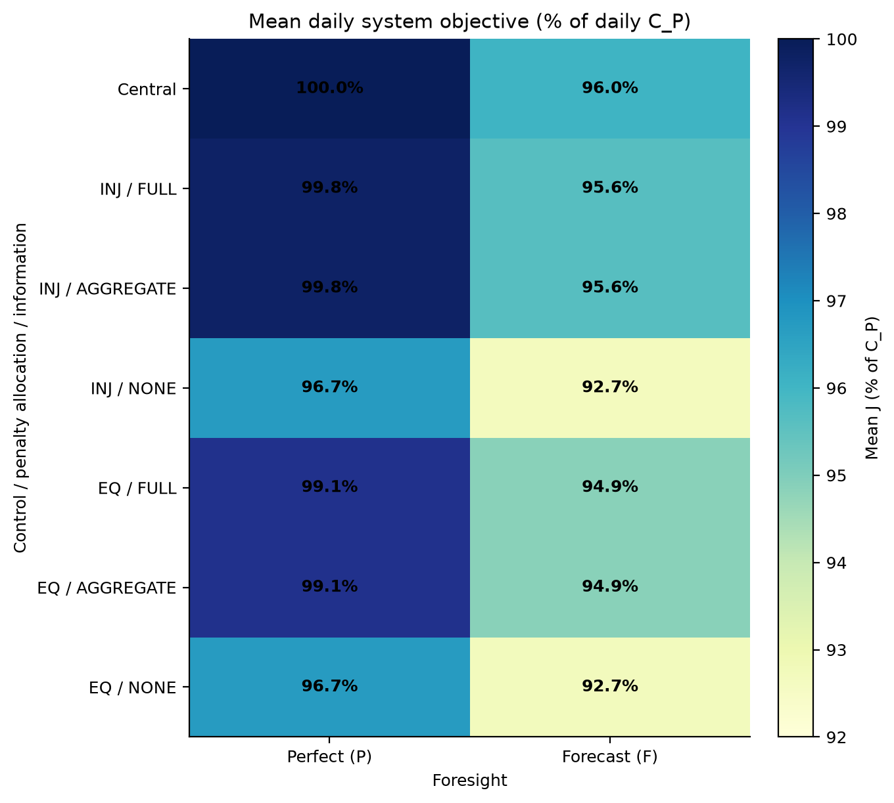
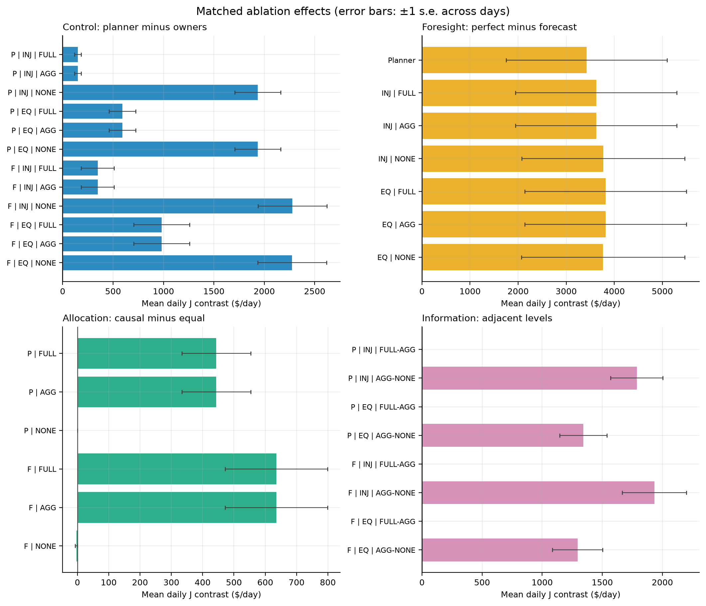

# Workshop 1 Report: Shared Wind-Storage Operation

Team: Nicolas Acevedo Villena, Subham Saha, and Ziqi Wei

## Scope

The experiment asks how control, foresight, overflow-blame allocation, and
information affect realized operating value for five Anchor Wind owners sharing
one export POI. It contains no minimum-delivery target or shortfall penalty.
DAM awards are retained as market data but are not physical operating limits.

## Matched design

| Dimension | Levels | Isolated change |
| --- | --- | --- |
| Control | planner / owners | joint versus separate decisions |
| Foresight | perfect / forecast | realized future versus COP wind and DA price forecasts |
| Penalty allocation | causal / equal | allocation of the same fixed attempted-overflow charge |
| Information | full / aggregate / none | owner plans, sufficient aggregate signal, or no current rival signal |

The historical `PRICE` cell identifier denotes **aggregate signal** in this
revision. It is not a congestion-price mechanism. FULL and aggregate use the
same payoff, constraints, sequential update, damping, and stopping criteria.

## Data and completion gates

- Operating window: 2025-03-01 to 2025-04-30.
- Complete operating days: 60.
- Cells: 14; day-cell observations: 840.
- Minimum owner converged-hour fraction: 1.000.
- Realized POI overflow and simultaneous battery operation: zero by validation.

## Mean system value

| Foresight | Planner | Causal full | Causal aggregate | Causal none | Equal full | Equal aggregate | Equal none |
| --- | --- | --- | --- | --- | --- | --- | --- |
| P | 61,951 | 61,801 | 61,801 | 60,015 | 61,358 | 61,358 | 60,015 |
| F | 58,524 | 58,177 | 58,177 | 56,244 | 57,541 | 57,541 | 56,247 |

## Matched factor contrasts

| Factor | Contrast | Held fixed | Mean ($/day) | Mean (% of C_P) |
| --- | --- | --- | --- | --- |
| F1 | C_P - mean(D_P_*) | foresight=P | 892.76 | 1.478 |
| F1 | C_P - D_P_INJ_FULL | foresight=P; share=INJ; info=FULL | 149.47 | 0.243 |
| F1 | C_P - D_P_INJ_AGGREGATE | foresight=P; share=INJ; info=AGGREGATE | 149.47 | 0.243 |
| F1 | C_P - D_P_INJ_NONE | foresight=P; share=INJ; info=NONE | 1,935.75 | 3.289 |
| F1 | C_P - D_P_EQ_FULL | foresight=P; share=EQ; info=FULL | 593.07 | 0.901 |
| F1 | C_P - D_P_EQ_AGGREGATE | foresight=P; share=EQ; info=AGGREGATE | 593.07 | 0.901 |
| F1 | C_P - D_P_EQ_NONE | foresight=P; share=EQ; info=NONE | 1,935.75 | 3.289 |
| F1 | C_F - mean(D_F_*) | foresight=F | 1,202.52 | 1.646 |
| F1 | C_F - D_F_INJ_FULL | foresight=F; share=INJ; info=FULL | 347.10 | 0.395 |
| F1 | C_F - D_F_INJ_AGGREGATE | foresight=F; share=INJ; info=AGGREGATE | 347.10 | 0.395 |
| F1 | C_F - D_F_INJ_NONE | foresight=F; share=INJ; info=NONE | 2,279.64 | 3.356 |
| F1 | C_F - D_F_EQ_FULL | foresight=F; share=EQ; info=FULL | 982.52 | 1.191 |
| F1 | C_F - D_F_EQ_AGGREGATE | foresight=F; share=EQ; info=AGGREGATE | 982.52 | 1.191 |
| F1 | C_F - D_F_EQ_NONE | foresight=F; share=EQ; info=NONE | 2,276.23 | 3.346 |
| F2 | C_P - C_F | control=C | 3,426.98 | 3.958 |
| F2 | D_P_INJ_FULL - D_F_INJ_FULL | control=D; share=INJ; info=FULL | 3,624.61 | 4.110 |
| F2 | D_P_INJ_AGGREGATE - D_F_INJ_AGGREGATE | control=D; share=INJ; info=AGGREGATE | 3,624.61 | 4.110 |
| F2 | D_P_INJ_NONE - D_F_INJ_NONE | control=D; share=INJ; info=NONE | 3,770.87 | 4.024 |
| F2 | D_P_EQ_FULL - D_F_EQ_FULL | control=D; share=EQ; info=FULL | 3,816.43 | 4.248 |
| F2 | D_P_EQ_AGGREGATE - D_F_EQ_AGGREGATE | control=D; share=EQ; info=AGGREGATE | 3,816.43 | 4.248 |
| F2 | D_P_EQ_NONE - D_F_EQ_NONE | control=D; share=EQ; info=NONE | 3,767.47 | 4.014 |
| F3 | D_P_INJ_FULL - D_P_EQ_FULL | control=D; foresight=P; info=FULL | 443.60 | 0.658 |
| F3 | D_P_INJ_AGGREGATE - D_P_EQ_AGGREGATE | control=D; foresight=P; info=AGGREGATE | 443.60 | 0.658 |
| F3 | D_P_INJ_NONE - D_P_EQ_NONE | control=D; foresight=P; info=NONE | -0.00 | -0.000 |
| F3 | D_F_INJ_FULL - D_F_EQ_FULL | control=D; foresight=F; info=FULL | 635.42 | 0.796 |
| F3 | D_F_INJ_AGGREGATE - D_F_EQ_AGGREGATE | control=D; foresight=F; info=AGGREGATE | 635.42 | 0.796 |
| F3 | D_F_INJ_NONE - D_F_EQ_NONE | control=D; foresight=F; info=NONE | -3.40 | -0.010 |
| F4 | D_P_INJ_FULL - D_P_INJ_AGGREGATE | control=D; foresight=P; share=INJ | 0.00 | 0.000 |
| F4 | D_P_INJ_AGGREGATE - D_P_INJ_NONE | control=D; foresight=P; share=INJ | 1,786.28 | 3.047 |
| F4 | D_P_INJ_FULL - D_P_INJ_NONE | control=D; foresight=P; share=INJ | 1,786.28 | 3.047 |
| F4 | D_P_EQ_FULL - D_P_EQ_AGGREGATE | control=D; foresight=P; share=EQ | 0.00 | 0.000 |
| F4 | D_P_EQ_AGGREGATE - D_P_EQ_NONE | control=D; foresight=P; share=EQ | 1,342.68 | 2.389 |
| F4 | D_P_EQ_FULL - D_P_EQ_NONE | control=D; foresight=P; share=EQ | 1,342.68 | 2.389 |
| F4 | D_F_INJ_FULL - D_F_INJ_AGGREGATE | control=D; foresight=F; share=INJ | 0.00 | 0.000 |
| F4 | D_F_INJ_AGGREGATE - D_F_INJ_NONE | control=D; foresight=F; share=INJ | 1,932.53 | 2.961 |
| F4 | D_F_INJ_FULL - D_F_INJ_NONE | control=D; foresight=F; share=INJ | 1,932.53 | 2.961 |
| F4 | D_F_EQ_FULL - D_F_EQ_AGGREGATE | control=D; foresight=F; share=EQ | 0.00 | 0.000 |
| F4 | D_F_EQ_AGGREGATE - D_F_EQ_NONE | control=D; foresight=F; share=EQ | 1,293.72 | 2.155 |
| F4 | D_F_EQ_FULL - D_F_EQ_NONE | control=D; foresight=F; share=EQ | 1,293.72 | 2.155 |

## Information sufficiency check

| Foresight | Allocation | Mean full - aggregate ($/day) | Maximum absolute difference ($/day) |
| --- | --- | --- | --- |
| P | INJ | 0.000000 | 0.000000 |
| P | EQ | 0.000000 | 0.000000 |
| F | INJ | 0.000000 | 0.000000 |
| F | EQ | 0.000000 | 0.000000 |

The maximum daily FULL-versus-aggregate difference is 0.000000 dollars.
Under the current aggregative payoff, owner identities provide no additional
decision-relevant quantity beyond aggregate rival injection. This is the direct
result of the matched information ablation, not evidence that information is
irrelevant in non-aggregative games.

## Operating diagnostics

| Cell | J ($/day) | Curtailment (MWh) | Throughput (MWh) | Attempted overflow (MWh) | Converged-hour fraction | Max gain ($) |
| --- | --- | --- | --- | --- | --- | --- |
| C_P | 61,951 | 1,408.6 | 258.7 | 0.0 | n/a | n/a |
| C_F | 58,524 | 1,429.8 | 221.3 | 0.0 | n/a | n/a |
| D_P_INJ_FULL | 61,801 | 1,403.2 | 277.9 | 28.8 | 1.000 | 0.358 |
| D_P_INJ_AGGREGATE | 61,801 | 1,403.2 | 277.9 | 28.8 | 1.000 | 0.358 |
| D_P_INJ_NONE | 60,015 | 1,467.3 | 349.9 | 460.1 | 1.000 | 0.000 |
| D_P_EQ_FULL | 61,358 | 1,420.2 | 302.6 | 154.1 | 1.000 | 0.244 |
| D_P_EQ_AGGREGATE | 61,358 | 1,420.2 | 302.6 | 154.1 | 1.000 | 0.244 |
| D_P_EQ_NONE | 60,015 | 1,471.6 | 345.6 | 460.1 | 1.000 | 0.000 |
| D_F_INJ_FULL | 58,177 | 1,424.0 | 248.4 | 31.9 | 1.000 | 0.833 |
| D_F_INJ_AGGREGATE | 58,177 | 1,424.0 | 248.4 | 31.9 | 1.000 | 0.833 |
| D_F_INJ_NONE | 56,244 | 1,481.0 | 307.1 | 458.1 | 1.000 | 0.000 |
| D_F_EQ_FULL | 57,541 | 1,439.3 | 271.9 | 159.7 | 1.000 | 0.771 |
| D_F_EQ_AGGREGATE | 57,541 | 1,439.3 | 271.9 | 159.7 | 1.000 | 0.771 |
| D_F_EQ_NONE | 56,247 | 1,482.5 | 304.8 | 457.6 | 1.000 | 0.000 |

## Interpretation boundary

The common reported objective is realized RT energy revenue less discharge
degradation. The attempted-overflow charge is a designed internal incentive and
is reported separately. Results describe one site, one 60-day spring window,
hourly resolution, fixed prices, and a proportional POI realization rule. They
do not represent full ERCOT market clearing or settlement.

See [DESIGN.md](../DESIGN.md), [ASSUMPTIONS.md](../ASSUMPTIONS.md), and the CSV
tables with metadata sidecars for the complete reproducibility record.
