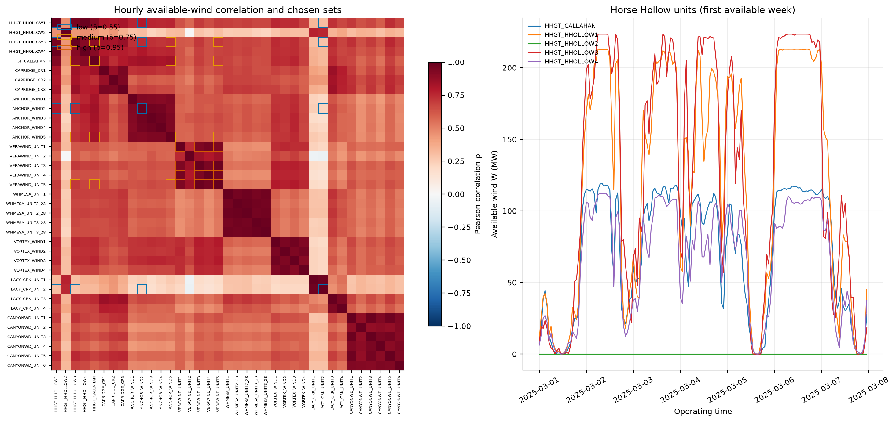
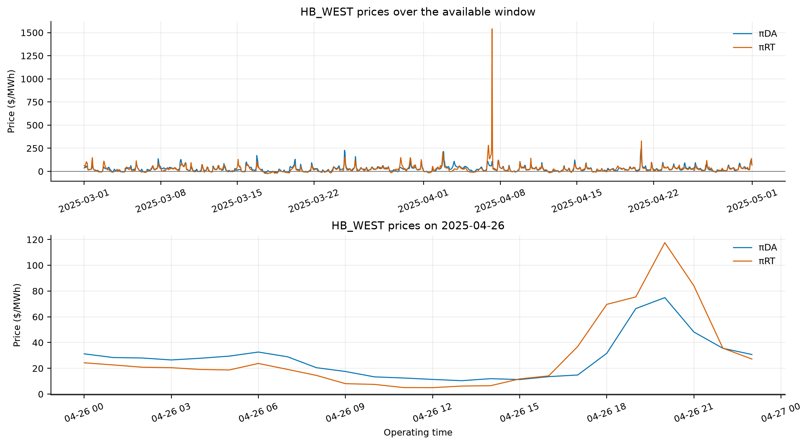
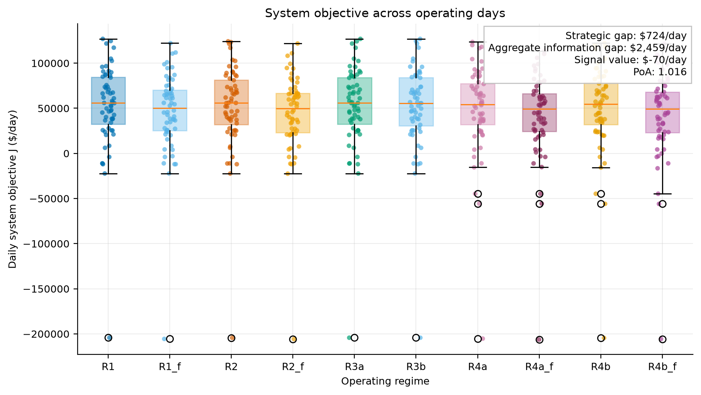
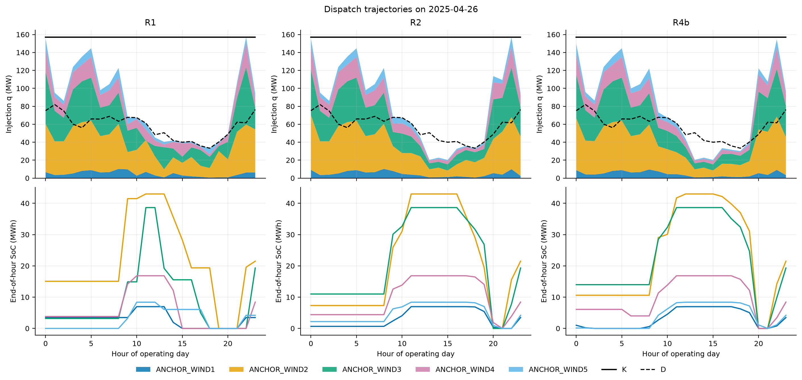
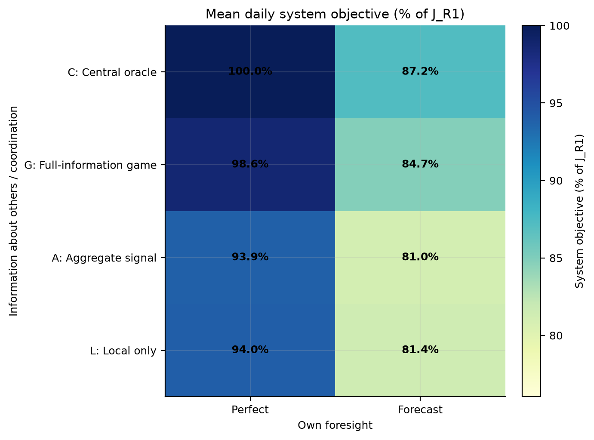
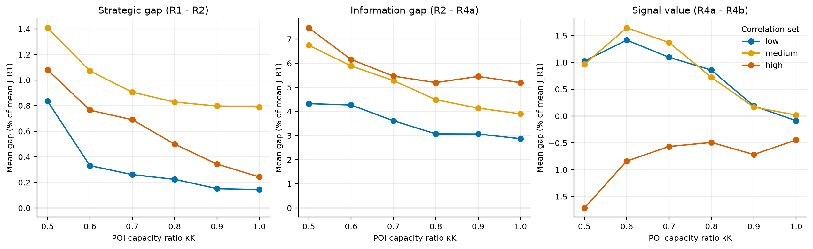
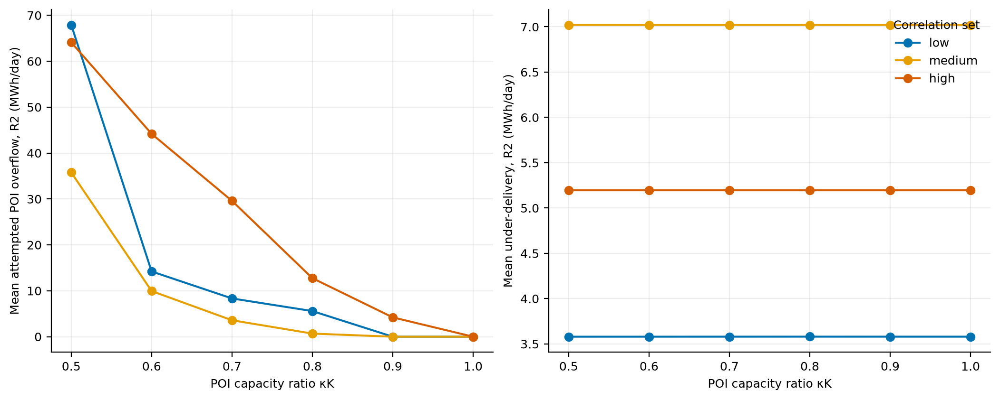
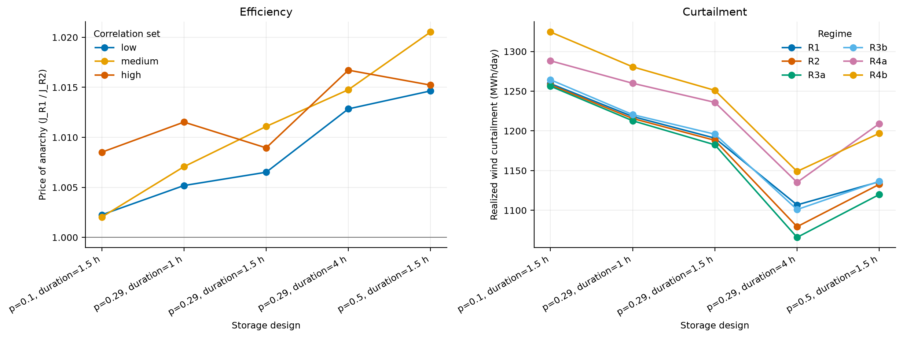
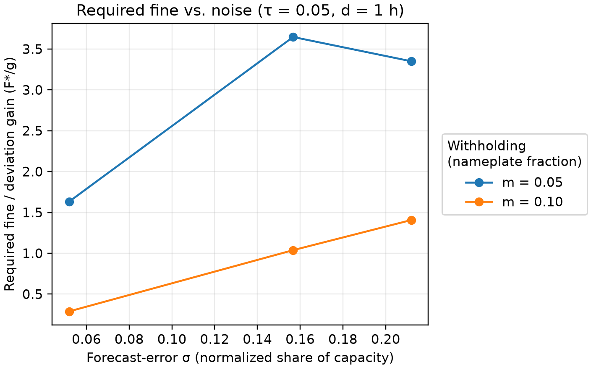
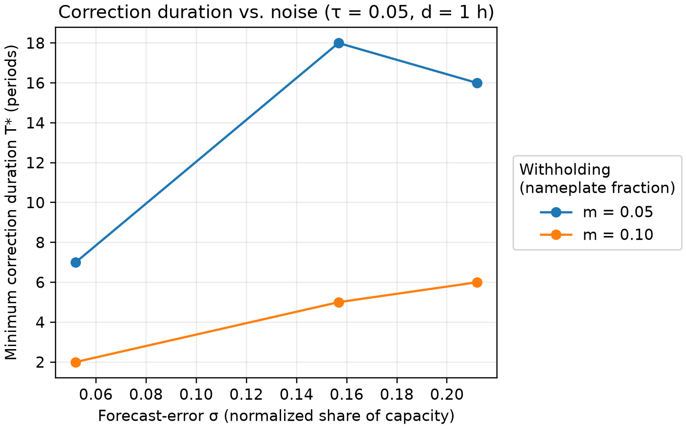

# Workshop 1 Report: Strategic Coordination in Co-Located Wind–Storage Systems

Team: Nicolás Acevedo Villena, Subham Saha, and Ziqi Wei  
Course: MIT 6.974 Wargame, Fall 2026

## Scope

This deliverable implements the Workshop 1 operating benchmark: a reproducible public-data pipeline, a real multi-resource wind–storage site with a shared POI, centralized and decentralized dispatch, a coordination-by-foresight matrix, sensitivity experiments, and empirical monitor calibration. MARL, adaptive monitoring, and resilience attacks remain later-workshop tasks.

## Data

| Quantity | Public source/report | Window used | Status |
| --- | --- | --- | --- |
| DA and RT prices | ERCOT NP4-180-ER and NP6-785-ER | 2025-03-01 to 2025-04-30 | Observed |
| Wind availability/output | ERCOT NP3-965-ER | 2025-03-01 to 2025-04-30 | Observed |
| COP forecast and baseline | ERCOT COP snapshot and NP3-966-ER | 2025-03-01 to 2025-04-30 | Observed/constructed |
| Forecast-error regimes | ERCOT NP4-732-CD and NP4-742-CD | Rolling MIS snapshot, publications 2026-10-13 … 10-20 (system level); 2025-03-01 … 04-30 (resource level) | Calibrated from observations |
| Battery design | Observed co-located BESS, EIA-860, NREL ATB | Base configuration | Calibrated |
| POI, delivery, penalties, information, monitor policy | Wargame design | Experiment grid | Designed |

The configured window is 2025-03-01 through 2025-04-30 at HB_WEST. It contains 60 complete daily episodes and 1 incomplete episode(s) across 61 calendar days; the base table evaluates all 60 complete episodes.

### Base-case resources: Anchor Wind

| Resource | Site | Nameplate (MW) | Coverage | Mean CF |
| --- | --- | --- | --- | --- |
| ANCHOR_WIND1 | Anchor Wind | 16.0 | 100.0% | 0.507 |
| ANCHOR_WIND2 | Anchor Wind | 98.8 | 100.0% | 0.601 |
| ANCHOR_WIND3 | Anchor Wind | 88.8 | 100.0% | 0.516 |
| ANCHOR_WIND4 | Anchor Wind | 38.7 | 100.0% | 0.585 |
| ANCHOR_WIND5 | Anchor Wind | 19.3 | 100.0% | 0.485 |

### Designed correlation sets

| Set | Members | Target ρ | Mean ρ | Range ρ | Nameplate (MW) |
| --- | --- | --- | --- | --- | --- |
| low | HHGT_HHOLLOW1, HHGT_HHOLLOW3, ANCHOR_WIND2, LACY_CRK_UNIT2 | 0.55 | 0.550 | 0.221–0.946 | 550.4 |
| medium | HHGT_HHOLLOW3, HHGT_CALLAHAN, ANCHOR_WIND5, VERAWIND_UNIT5 | 0.75 | 0.750 | 0.641–0.897 | 459.5 |
| high | VERAWIND_UNIT1, VERAWIND_UNIT3, VERAWIND_UNIT4, VERAWIND_UNIT5 | 0.95 | 0.950 | 0.932–0.982 | 232.5 |

*The selected low, medium, and high sets have mean correlations 0.55, 0.75, and 0.95 (within the low set, pairwise ρ ranges from 0.22 to 0.95), so the sensitivity grid spans materially different coincidence in wind availability.*

*DA and RT prices range from $-26.66 to $1,540.68/MWh, the largest forecast loss coincides with the window's price maximum, and across days the correlation between the daily forecast gap and the daily maximum RT price is r = 0.83.*

[ASSUMPTIONS.md](../ASSUMPTIONS.md) records every source and status. Prices, wind, forecasts, awards, and resource metadata are observed; nameplate, storage size, efficiency, degradation cost, and monitor-noise regimes are calibrated; K, D, λ⁻ = 250 $/MWh, information structures, thresholds, and enforcement parameters are designed.

Base parameters: kappa_K = 0.6, delta_D = 0.5, λ⁻ = 250, λ⁺ = 100 $/MWh, p = 0.29, E/P = 1.5 h, η_RT = 0.85, C_deg = 10 $/MWh (config/base.yaml)

## Model summary

The physical and strategic model follows [DESIGN.md §3–§4](../DESIGN.md). Its realized system objective is `J = raw realized profit − λ⁻ × under-delivery`; λ⁺ is excluded from realized J because the realization layer enforces K. Attempted overflow remains a strategic diagnostic. Every gap and PoA below leads with J; raw-profit counterparts are retained separately.

## Headline results

| Regime | System objective J ($/day) | Raw profit ($/day) | Curtailment (MWh) | Throughput (MWh) | Under-delivery (MWh) | Overflow attempt (MWh) | Converged |
| --- | --- | --- | --- | --- | --- | --- | --- |
| R1 | 51,772 | 57,764 | 893.6 | 251.9 | 24.0 | 0.0 | n/a |
| R1_f | 45,158 | 54,700 | 902.6 | 230.0 | 38.2 | 0.0 | n/a |
| R2 | 51,048 | 57,666 | 895.9 | 290.6 | 26.5 | 45.5 | 97% |
| R2_f | 43,875 | 54,003 | 908.9 | 272.6 | 40.5 | 50.4 | 90% |
| R3a | 51,724 | 57,717 | 887.4 | 258.0 | 24.0 | 0.0 | 80% |
| R3b | 51,380 | 57,373 | 892.2 | 250.3 | 24.0 | 0.0 | 90% |
| R4a | 48,589 | 57,428 | 921.2 | 261.5 | 35.4 | 47.5 | n/a |
| R4a_f | 41,956 | 54,019 | 933.0 | 242.1 | 48.2 | 52.7 | n/a |
| R4b | 48,659 | 57,491 | 914.6 | 262.5 | 35.3 | 0.0 | n/a |
| R4b_f | 42,147 | 54,160 | 936.6 | 227.1 | 48.1 | 0.0 | n/a |

| Objective-based gap | Mean ($/day) | Median ($/day) | Mean of daily % of J_R1 | Maximum ($/day) |
| --- | --- | --- | --- | --- |
| Strategic gap | 723.80 | 193.21 | 1.49 | 9,588.18 |
| Aggregate-information gap | 2,458.51 | 1,060.16 | 3.30 | 43,584.39 |
| Local-information gap | 2,388.79 | 1,116.17 | 3.21 | 43,911.46 |
| Aggregate-signal value | -69.73 | 0.00 | -0.08 | 1,823.48 |
| Central forecast gap | 6,613.39 | 2,142.28 | 12.51 | 101,069.24 |
| Game forecast gap | 7,173.28 | 1,829.63 | 12.91 | 101,659.64 |
| Aggregate-MPC forecast gap | 6,633.01 | 1,780.68 | 11.95 | 100,206.61 |

| Efficiency ratio | Objective mean | Objective median | Raw-profit mean | Raw-profit median |
| --- | --- | --- | --- | --- |
| R1 / R2 | 1.016 | 1.004 | 1.004 | 1.002 |
| R1_f / R2_f | 1.019 | 1.010 | 1.013 | 1.005 |

Raw-profit comparisons omit the system shortage charge:

| Raw-profit gap | Mean ($/day) | Median ($/day) | Mean of daily % of R1 profit | Maximum ($/day) |
| --- | --- | --- | --- | --- |
| Strategic gap | 98.24 | 131.56 | 0.31 | 2,049.25 |
| Aggregate-information gap | 238.23 | 20.43 | 0.30 | 3,531.40 |
| Local-information gap | 175.28 | 61.17 | 0.23 | 3,477.23 |
| Aggregate-signal value | -62.95 | 0.00 | -0.07 | 1,823.48 |
| Central forecast gap | 3,064.67 | 826.16 | 3.61 | 106,253.07 |
| Game forecast gap | 3,663.44 | 1,263.06 | 4.53 | 106,029.74 |
| Aggregate-MPC forecast gap | 3,409.24 | 840.60 | 4.34 | 106,840.37 |

The strategic gap is small on a typical day but heavy-tailed: its mean is $724/day versus a $193/day median, and the gap exceeds $100 on 37 of 60 days. Of the mean strategic gap (J_R1 − J_R2 = $724/day), R3a (full exposure to the shared shortage/overflow penalties) recovers 93.5% and R3b (R3a plus the POI dual price broadcast) recovers 45.9%; R3a recovers more. Because R3b recovers less than R3a, charging the central dual price on injections acts as a tax without rebate and reduces J. The mean aggregate-information gap (R2 − R4a) is $2,459/day (4.7% of mean J_R1) versus a mean strategic gap (R1 − R2) of $724/day (1.4%); the mean headroom-signal value (R4a − R4b) is -$70/day (-0.1% of mean J_R1), so the signal does not help on average. The three largest days are:

| Day | Strategic gap ($) | Gap (% J_R1) | Max RT price ($/MWh) | Wind availability (MWh) |
| --- | --- | --- | --- | --- |
| 2025-04-26 | 9,588 | 19.3 | 117.58 | 2,010.7 |
| 2025-03-10 | 4,752 | 9.9 | 94.34 | 1,061.2 |
| 2025-03-01 | 3,567 | 4.8 | 148.07 | 1,617.2 |

R4a exceeds R2 on 12 of 60 days. On those days only, mean attempted overflow is 116.5 MWh in R2 versus 59.4 MWh in R4a; mean throughput is 221.3 MWh in R2 versus 152.8 MWh in R4a. On those days, R4a's advantage is associated with less attempted shared-POI overflow and less throughput. Over all 60 days, the mean attempted overflow is 45.5 MWh in R2 and 47.5 MWh in R4a, so R4a attempts more overflow than R2 over all days.

The central forecast gap dominates the other average losses: it averages $6,613/day, or 12.5 % of daily J_R1 on average, versus a median $2,142/day and 3.6 %. The worst day is 2025-04-07, with a $101,069 gap and a maximum RT price of $1,540.68/MWh; the largest forecast loss coincides with the window's price maximum (on 2025-04-07). Across the 60 days, the correlation between the daily forecast gap and the daily maximum RT price is r = 0.83.

*R1 has the highest mean J ($51,772/day), R4a_f has the lowest ($41,956/day), and a few extreme days dominate the strategic-gap mean.*

*On 2025-04-26, the objective spread among R1, R2, and R4b is $11,227, on the day with the largest strategic gap in the window. Relative to R1, throughput is essentially unchanged (291.2 MWh in R2 versus 291.2 MWh in R1), and under-delivery is 80.4 MWh in R2 versus 13.3 MWh in R1.*

## Information-structure matrix

| Coordination | Perfect J ($/day) | Forecast J ($/day) | Perfect raw profit | Forecast raw profit |
| --- | --- | --- | --- | --- |
| C | 51,772 | 45,158 | 57,764 | 54,700 |
| G | 51,048 | 43,875 | 57,666 | 54,003 |
| A | 48,589 | 41,956 | 57,428 | 54,019 |
| L | 48,659 | 42,147 | 57,491 | 54,160 |

| Coordination | Perfect (% J_R1) | Forecast (% J_R1) | Perfect (% R1 profit) | Forecast (% R1 profit) |
| --- | --- | --- | --- | --- |
| C | 100.0 | 87.2 | 100.0 | 94.7 |
| G | 98.6 | 84.7 | 99.8 | 93.5 |
| A | 93.9 | 81.0 | 99.4 | 93.5 |
| L | 94.0 | 81.4 | 99.5 | 93.8 |

*The lowest matrix cell in J is A under forecast foresight, while the perfect-to-forecast column change is much larger than the differences across coordination rows.*

## Sensitivity

Full grid: κK ∈ {0.5, 0.6, 0.7, 0.8, 0.9, 1.0}, 3 correlation sets, 5 storage designs, 20 days (every 3rd day), 6 regimes. The grid has 90 κK-by-correlation-by-storage configurations. All gaps below use J and are computed from configuration means over days (mean J by regime, then ratios). Figures and the tables below use the base storage design (p=0.29, duration=1.5 h) unless stated.

| Configuration-level finding (means over days) | Configuration / κK | Value |
| --- | --- | --- |
| Largest mean strategic gap | κK = 0.50, medium, p=0.29, duration=4 h | 2.97% of mean J_R1 |
| Largest mean information gap (R2 − R4a) | κK = 0.50, high, p=0.5, duration=1.5 h | 8.42% of mean J_R1 |
| Mean strategic gap first exceeds 1 % of J_R1 (loosest-to-tightest κK), low set, p=0.29, duration=1.5 h | never above 1 % on the grid |  |
| Mean strategic gap first exceeds 1 % of J_R1 (loosest-to-tightest κK), medium set, p=0.29, duration=1.5 h | κK = 0.60 |  |
| Mean strategic gap first exceeds 1 % of J_R1 (loosest-to-tightest κK), high set, p=0.29, duration=1.5 h | κK = 0.50 |  |
| Highest mean PoA at κK = 0.60 | p=0.29, duration=4 h | 1.0193 |
| Lowest mean PoA at κK = 0.60 | p=0.1, duration=1.5 h | 1.0038 |
| Largest mean attempted overflow (R2) | κK = 0.50, low, p=0.29, duration=4 h | 115.7 MWh/day |
| Largest mean under-delivery (R2) | κK = 0.60, high, p=0.1, duration=1.5 h | 14.7 MWh/day |

Mean strategic gap (R1 − R2, % of mean J_R1) by POI tightness and correlation set:

| κK | low set | medium set | high set |
| --- | --- | --- | --- |
| 0.50 | 0.84 % | 1.41 % | 1.08 % |
| 0.60 | 0.33 % | 1.07 % | 0.76 % |
| 0.70 | 0.26 % | 0.91 % | 0.69 % |
| 0.80 | 0.22 % | 0.83 % | 0.50 % |
| 0.90 | 0.15 % | 0.80 % | 0.34 % |
| 1.00 | 0.14 % | 0.79 % | 0.24 % |

Mean information gap (R2 − R4a, % of mean J_R1):

| κK | low set | medium set | high set |
| --- | --- | --- | --- |
| 0.50 | 4.33 % | 6.74 % | 7.46 % |
| 0.60 | 4.27 % | 5.89 % | 6.15 % |
| 0.70 | 3.62 % | 5.28 % | 5.47 % |
| 0.80 | 3.07 % | 4.49 % | 5.20 % |
| 0.90 | 3.07 % | 4.14 % | 5.45 % |
| 1.00 | 2.87 % | 3.90 % | 5.19 % |

At κK = 1.0 the POI does not bind, so the remaining information gap (low 2.87 %, medium 3.90 %, high 5.19 % of J_R1) cannot come from POI competition; it measures the cost of private delivery commitments in the limited-information regimes, where each agent must cover its own D_i = δ_D·b_i because it cannot observe the aggregate shortfall, whereas game agents share the aggregate D.

*At the base storage design (p=0.29, duration=1.5 h; configuration means over days), the strategic gap for the high-correlation set is 0.24 % of J_R1 at κK = 1.0 and 1.08 % at κK = 0.5, versus 0.14 % and 0.84 % for the low set; the information gap for the high set goes from 5.19 % to 7.46 %, and signal value from -0.45 % to -1.72 % (20 days, every 3rd day). The aggregate headroom signal changes J by 1.42 % (low) and 1.64 % (medium) versus -0.84 % (high) of J_R1 at κK = 0.6 (positive means the signal helps). Both gaps grow as the POI tightens; at κK = 0.5 the strategic gap is largest for the medium set and the information gap for the high set.*

*For the high-correlation set at the base storage design, mean R2 attempted overflow rises from 0.0 MWh/day at κK = 1.0 to 64.1 MWh/day at κK = 0.5 and mean under-delivery moves from 5.2 to 5.2 MWh/day (the low set: 67.9 and 3.6 MWh/day at κK = 0.5); the realization layer keeps physical export within K (20 days, every 3rd day).*

*Configuration-mean PoA spans 1.001–1.031 over the grid and, at κK = 0.60, from 1.0038 (p=0.1, duration=1.5 h) to 1.0193 (p=0.29, duration=4 h), so storage design changes both efficiency and curtailment; the design with the largest mean PoA is p=0.29, duration=4 h (1.016); mean realized curtailment differs by 168.9 MWh/day between the designs with the smallest (p=0.29, duration=4 h, 1,106.2) and largest (p=0.1, duration=1.5 h, 1,275.2) mean curtailment (20 days, every 3rd day).*

## Monitor calibration

The low, medium, and high σ regimes come from real data. Results are given for both absolute thresholds and both withholding levels at δ = 0.98 and d = 4.

| Noise | σ | τ/nameplate | m/nameplate | q0 | q1 | δ | d (h) | F*/g | F*·κ/g | Feasible (F* ≤ F̄ = 3g) | T* |
| --- | --- | --- | --- | --- | --- | --- | --- | --- | --- | --- | --- |
| low | 0.052 | 0.05 | 0.05 | 0.087 | 0.442 | 0.98 | 4 | 1.81 | 1.63 | yes | 8 |
| low | 0.052 | 0.05 | 0.10 | 0.087 | 0.812 | 0.98 | 4 | 0.38 | 0.34 | yes | 2 |
| low | 0.052 | 0.10 | 0.05 | 0.005 | 0.087 | 0.98 | 4 | 12.18 | 10.98 | no | 182 |
| low | 0.052 | 0.10 | 0.10 | 0.005 | 0.442 | 0.98 | 4 | 1.47 | 1.33 | yes | 7 |
| medium | 0.157 | 0.05 | 0.05 | 0.270 | 0.431 | 0.98 | 4 | 4.04 | 2.95 | no | 20 |
| medium | 0.157 | 0.05 | 0.10 | 0.270 | 0.638 | 0.98 | 4 | 1.21 | 0.89 | yes | 6 |
| medium | 0.157 | 0.10 | 0.05 | 0.173 | 0.269 | 0.98 | 4 | 8.41 | 6.15 | no | 56 |
| medium | 0.157 | 0.10 | 0.10 | 0.173 | 0.431 | 0.98 | 4 | 2.53 | 1.85 | yes | 12 |
| high | 0.212 | 0.05 | 0.05 | 0.364 | 0.515 | 0.98 | 4 | 3.77 | 2.47 | no | 18 |
| high | 0.212 | 0.05 | 0.10 | 0.364 | 0.637 | 0.98 | 4 | 1.64 | 1.07 | yes | 7 |
| high | 0.212 | 0.10 | 0.05 | 0.274 | 0.364 | 0.98 | 4 | 7.92 | 5.18 | no | 50 |
| high | 0.212 | 0.10 | 0.10 | 0.274 | 0.515 | 0.98 | 4 | 2.35 | 1.54 | yes | 11 |

In the medium regime (resource-level COP σ = 0.157 of nameplate), a 5% withholding at a 5% threshold raises sanction probability only from q0 = 0.270 to q1 = 0.431, so it is detectable only weakly and with a substantial false-positive rate.

*The ROC curves overlap substantially across calibrated regimes, so a threshold that suppresses false positives also misses a material share of small withholding. Empirical AUC at m = 0.05 of nameplate: low 0.74, medium 0.56, high 0.54.*

*Required F*/g increases when q1 separates less from q0, making small withholding expensive to deter under noisier signals.*

*Finite correction periods lengthen sharply when detection gain q1 − q0 is small; some low-detection combinations are not finitely deterrable on the plotted horizon (T_max = 10,000 periods); for example, regime low with τ = 0.10 of nameplate and m = 0.02 of nameplate (d = 1 h) has T* = ∞.*

## What we learned / what breaks

- The mean strategic gap is 1.5 % of daily J_R1, with a $193 median and a $9,588 maximum, so the mean is not representative of a typical day.
- R4a beats the full-information Nash outcome on 12 days; on those days it is associated with less throughput and less attempted shared-POI overflow, although over all days R4a's mean attempted overflow is 47.5 MWh versus 45.5 MWh in R2.
- Perfect foresight is worth an average of 12.5 % of daily J_R1, larger than the mean strategic and information effects.
- Best-response regimes converge in 89.2% of evaluated base-day runs (converged requires residual ≤ tol and maximum unilateral gain ≤ $1); non-converged runs are not a tolerance artefact: over all R2/R3a/R3b day-runs the largest remaining unilateral gain is $12.39, i.e. 0.02 % of mean J_R1 (mean $0.57, 0.001 %). Convergence does not imply system optimality.
- Sensitivity (means over days at the base storage design): tightening the POI from κK = 1.0 to 0.5 moves the strategic gap from 0.39 % to 1.11 % of J_R1 and the information gap (R2 − R4a) from 3.99 % to 6.18 % (averaged over correlation sets); at κK = 0.6, going from the low- to the high-correlation set moves the strategic gap from 0.33 % to 0.76 % and the information gap from 4.27 % to 6.15 %; the mean strategic gap increases with storage duration (1.0 h: 0.60 %, 1.5 h: 0.72 %, 4.0 h: 1.90 % at κK = 0.60, p = 0.29).
- Coordination mechanisms: Of the mean strategic gap (J_R1 − J_R2 = $724/day), R3a (full exposure to the shared shortage/overflow penalties) recovers 93.5% and R3b (R3a plus the POI dual price broadcast) recovers 45.9%; R3a recovers more. Because R3b recovers less than R3a, charging the central dual price on injections acts as a tax without rebate and reduces J.
- Information versus strategy: The mean aggregate-information gap (R2 − R4a) is $2,459/day (4.7% of mean J_R1) versus a mean strategic gap (R1 − R2) of $724/day (1.4%); the mean headroom-signal value (R4a − R4b) is -$70/day (-0.1% of mean J_R1), so the signal does not help on average.
- With medium resource-level noise, a small withholding remains difficult to separate from legitimate forecast error: at m = 0.05 and τ = 0.05 of nameplate, q1 − q0 = 0.162.

## Limitations

The base results cover 60 complete episodes in one spring window at one co-located site. Full grid: κK ∈ {0.5, 0.6, 0.7, 0.8, 0.9, 1.0}, 3 correlation sets, 5 storage designs, 20 days (every 3rd day), 6 regimes. The forecast-error (monitor) regimes rest on a rolling MIS snapshot (publications 2026-10-13 … 10-20 at system level; resource-level data for 2025-03-01 … 04-30), so the system-level noise is calibrated on a different period from the operating window. The model is price-taking at RT, uses deterministic COP and DA forecasts inside MPC, and does not yet model two-settlement bidding, endogenous prices, outages, causal intent, or attacks.

## Post-Workshop-1 roadmap

Next steps are MARL under local and aggregate observations, adaptive thresholds and enforcement, explicit withholding and false-data attacks, and resilience mechanisms. Those extensions will retain this objective definition, centralized benchmark, realization layer, and reproducible data split.
