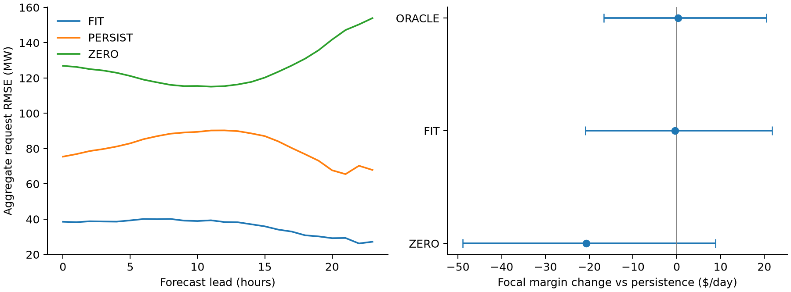

# Aggregate Rival Forecasting: First Simulation

## Design

Five focal-owner rotations, four fixed persistence-policy opponents, 20 test days,
and four focal treatments: ZERO, PERSIST, FIT, ORACLE. All use the same candidate
controller, wind-only batteries, actual accepted-export revenue, degradation,
and terminal-return requirement. Overflow charges are zero. Own wind and prices
have perfect foresight. Coefficients are fitted on the first 30 complete days;
the next 10 select the reference policy and ridge parameter. Test dates are
April 11–30, 2025. The physical initial SOC resets daily; observable forecast
histories continue across days. All treatments start from the same pilot history.

The controller projects actions onto terminal-reachable SOC before realization:

$$
s_{i,t+1}^{plan}\ge
\left[s_{i0}-\eta_c\sum_{u=t+1}^{23}\min(P_i,W_{iu})\right]_+.
$$

This common adjustment preserves the original return requirement. It is an
implementation refinement to the threshold controller in model_formulation.md.
The candidate score uses the original activity cost; reported J excludes it.

Current actions are simultaneous. Only own request and acceptance update the
past aggregate estimate. Binding positive exports identify past rival total
requests; nonbinding observations supply an upper bound. Censored regression
uses both. FIT coefficients remain frozen during testing. The initial forecast
is 0.5 times total rival nameplate, and the initial observation age is 168 hours.

ORACLE evaluates candidate-conditional opponent trajectories with their private
wind and SOC, then implements its selected first action. Its forecast RMSE is
undefined because it uses simulator rollouts rather than an observable predictor.
The first run covers deterministic forecasts (M=1); scenario sampling and
simultaneous adaptation are separate experiments.

Selected reference [low threshold, high threshold, beta]: [16.3325, 154.6175, 0.0].
Selected ridge: 0.0001. Candidates: 61.
Runtime: 7.4 seconds. Physical, wind-only, simultaneous-operation, and
terminal-return checks passed for every executed interval/day.

## Mean daily results

J is the focal owner's operating margin in dollars/day. system_J sums all five
owners within that rotation. Forecast errors use evaluator-only private truth;
that truth never enters ZERO, PERSIST, or FIT actions. exact_hours counts hours
where own metering identifies rival total requests.

| method | J | system_J | attempted_overflow_mwh | rejected_mwh | throughput_mwh | exact_hours | forecast_rmse_mw |
| --- | --- | --- | --- | --- | --- | --- | --- |
| FIT | 13231.043 | 64166.651 | 566.107 | 112.853 | 46.721 | 10.580 | 38.542 |
| ORACLE | 13231.735 | 64169.503 | 566.775 | 113.089 | 46.127 | 10.590 | nan |
| PERSIST | 13231.410 | 64173.597 | 567.063 | 113.252 | 44.883 | 10.570 | 75.443 |
| ZERO | 13210.675 | 64097.787 | 570.157 | 115.029 | 51.685 | 10.570 | 126.918 |

## Paired focal margin relative to persistence

Average across five focal rotations within each day, then bootstrap the 20 day
blocks (1,000 draws, seed 6974). Intervals are descriptive paired-day bootstrap
intervals for this test window.

| method | reference | mean_delta_J | ci_low | ci_high | days |
| --- | --- | --- | --- | --- | --- |
| ZERO | PERSIST | -20.735 | -48.906 | 8.873 | 20 |
| PERSIST | PERSIST | 0.000 | 0.000 | 0.000 | 20 |
| FIT | PERSIST | -0.368 | -20.867 | 21.811 | 20 |
| ORACLE | PERSIST | 0.325 | -16.627 | 20.469 | 20 |

## Interpretation

The fitted current-hour predictor reduces RMSE from 75.44 MW to
38.54 MW. Its mean focal operating-margin difference from persistence is
-0.37 dollars/day, with a paired-day interval of
[-20.87, 21.81]. This test does not establish a
positive economic gain from the fitted model. The ideal-information controller
also yields a small mean improvement within this threshold-policy class.

The fixed reference selected beta=0 and a high discharge threshold. These
opponents do not strategically respond to congestion forecasts, although their
battery states and later requests respond physically to export curtailment.
Conclusions apply to this reference behavior, candidate policy class, and test
window. Joint adaptive operation remains a separate comparison.

## Artifacts

- trajectories.csv: every owner's hourly request, acceptance, SOC, actions,
  forecasts, and observation availability for each focal treatment.
- daily.csv: focal and system outcomes by day and rotation.
- forecast_paths.csv and forecast_by_lead.csv: forecasts made at each origin and
  evaluator-only errors against subsequently executed rival requests, by horizon.
- reference_selection.csv and ridge_selection.csv: validation selections.
- training_observations.csv: common pilot histories for training and validation.
- fitted_model.npz: coefficients and candidate controllers.
- CSV metadata: exact splits, source hashes, objective and configuration hash.
