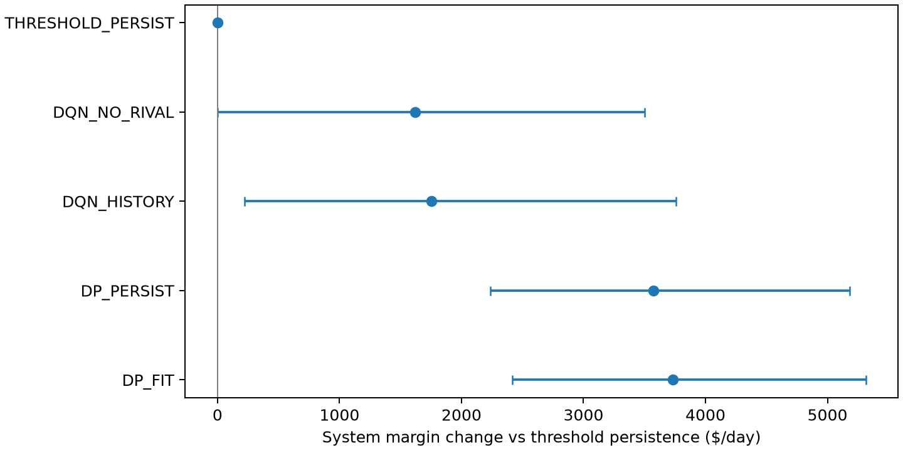

# Dispatch Improvement and Reinforcement Learning

## Algorithms

The earlier controllers used regression/filter forecasts and threshold-policy
rollouts. This study adds finite-grid battery dynamic programming (DP) and
independent Double DQN. Five owners act simultaneously with private execution.
Each DQN receives only its own SOC, wind, permitted future own wind/prices, and
past inferred aggregate rival requests. DQN_NO_RIVAL masks the last-request and
observation-age fields. It retains the same architecture and training budget.

DP uses 81 energy grid points and 9 battery commands.
It optimizes accepted revenue, executed discharge degradation and the same
activity tie-break cost. DP_PERSIST and DP_FIT differ only in the rival forecast.
DQN uses the same commands and feasibility projection, with actual individual
operating margin as reward. Negative-price wind can be curtailed freely.

DQN subtracts an action-independent, own-wind energy-revenue baseline and scales
rewards by 100 times owner nameplate. This changes neither daily policy ranking
nor the monetary evaluation. Episodes reset at midnight; discount is 1. Targets
use online action selection with a separate target network. Training replay
contains March simulated transitions only. All five independent Q functions
train together; execution reveals no contemporaneous rival actions or SOC.

There are 600 training episodes per seed and ablation. Checkpoints
are selected on April 1–10 only. April 11–30 has appeared in prior experiments,
so results below are retrospective evaluation, not a fresh holdout claim.
Hyperparameters are fixed in config/rl.yaml. Seeds: [6974, 6975, 6976].

## Mean system margin ($/day)

| method | system_J |
| --- | --- |
| DP_FIT | 68894.678 |
| DP_PERSIST | 68734.227 |
| DQN_HISTORY | 66914.602 |
| DQN_NO_RIVAL | 66783.670 |
| THRESHOLD_PERSIST | 65161.343 |

## Paired differences ($/day)

Seeds are averaged within day before bootstrapping 20 paired day blocks.
THRESHOLD_PERSIST is the earlier controller; DP_PERSIST is the stronger
same-command-set planning baseline. Intervals use 1,000 draws, seed 6974.

| method | reference | delta_J | low | high |
| --- | --- | --- | --- | --- |
| DP_FIT | THRESHOLD_PERSIST | 3733.335 | 2417.186 | 5314.718 |
| DP_FIT | DP_PERSIST | 160.451 | -25.630 | 349.696 |
| DP_PERSIST | THRESHOLD_PERSIST | 3572.884 | 2235.792 | 5183.699 |
| DP_PERSIST | DP_PERSIST | 0.000 | 0.000 | 0.000 |
| DQN_HISTORY | THRESHOLD_PERSIST | 1753.259 | 223.949 | 3760.791 |
| DQN_HISTORY | DP_PERSIST | -1819.626 | -2558.220 | -1095.223 |
| DQN_NO_RIVAL | THRESHOLD_PERSIST | 1622.327 | -0.811 | 3501.412 |
| DQN_NO_RIVAL | DP_PERSIST | -1950.557 | -2765.779 | -1254.012 |
| THRESHOLD_PERSIST | THRESHOLD_PERSIST | 0.000 | 0.000 | 0.000 |
| THRESHOLD_PERSIST | DP_PERSIST | -3572.884 | -5184.859 | -2181.461 |


## Artifacts

The result directory contains per-owner hourly dispatch, per-seed daily values,
March reward/loss traces, validation checkpoint scores, selected model weights,
source hashes and the effective configuration. Physical battery bounds, wind-only
charging, terminal return and the shared POI limit are checked during every run.

## Validation-only algorithm ranking

Selected models are evaluated on April 1–10 with a training-only initial history.
Algorithm-family values average the three selected checkpoints where applicable.
The highest validation value selects DP_PERSIST.

| method | validation_J |
| --- | --- |
| DP_PERSIST | 68705.494 |
| DP_FIT | 68693.535 |
| DQN_NO_RIVAL | 63092.673 |
| DQN_HISTORY | 61809.127 |
| THRESHOLD_PERSIST | 53660.546 |

## Value of rival information

These contrasts retain the same battery command set within each pair.

| method | reference | delta_J | low | high |
| --- | --- | --- | --- | --- |
| DQN_HISTORY | DQN_NO_RIVAL | 130.932 | -35.883 | 307.443 |
| DP_FIT | DP_PERSIST | 160.451 | -25.630 | 349.696 |

## Findings

The previous threshold controller earns 65161.34 dollars/system-day in the
retrospective window. DP with fitted forecasts earns 68894.68,
a change of 5.73%. DQN with rival history earns
66914.60, a change of 2.69%.

The dominant measured improvement comes from battery control. The information
contrasts above do not isolate a clear additional economic gain when their day
intervals include zero. DQN improves on the old threshold controller but does not
outperform the DP baseline at this training budget. Validation ranking supports
using the DP controller as the next working baseline.



## Reproduction

```bash
PYTHONPATH=code OPENBLAS_NUM_THREADS=1 OMP_NUM_THREADS=1 .venv/bin/python code/scripts/11_rl_dispatch.py
PYTHONPATH=code OPENBLAS_NUM_THREADS=1 OMP_NUM_THREADS=1 .venv/bin/python code/scripts/12_validate_dispatch.py
```
