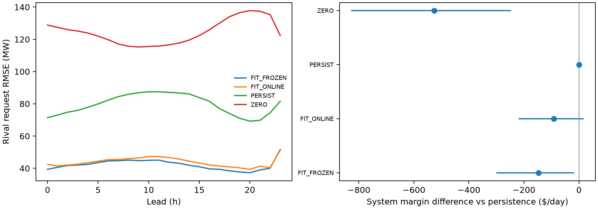

# Stage 1: Simultaneous Aggregate Learning

All five owners choose dispatch simultaneously from their own pre-action histories.
Own wind and prices have perfect foresight. Batteries, POI, terminal return,
actual-revenue objective and candidate controller match the focal-owner study.
No overflow penalty is charged. No current rival request or SOC enters a policy.

ZERO and PERSIST use fixed forecasting rules. FIT_FROZEN uses the original
training coefficients. FIT_ONLINE refits the censored regression once per day,
using the common training history plus its own completed test-day observations.
Current and future test-day labels are excluded. Validation selects the ridge
and threshold grid before testing. All methods start with the same pilot history.
SOC resets daily; observable histories carry forward. Each method runs 20 test
days, giving 80 joint operating days and 9,600 owner-hour observations.

## Results

| method | system_J | overflow_mwh | rmse_mw |
| --- | --- | --- | --- |
| FIT_FROZEN | 65014.498 | 578.641 | 39.388 |
| FIT_ONLINE | 65069.885 | 575.405 | 42.361 |
| PERSIST | 65161.343 | 576.342 | 71.392 |
| ZERO | 64634.663 | 597.902 | 128.838 |

## Paired system margin versus persistence

The unit is dollars per system-day. Intervals bootstrap 20 paired day blocks,
1,000 draws, seed 6974. These are adaptive dispatch comparisons; the output does
not certify a dynamic-game equilibrium.

| method | delta_system_J | low | high |
| --- | --- | --- | --- |
| FIT_FROZEN | -146.845 | -300.596 | -17.193 |
| FIT_ONLINE | -91.457 | -219.830 | 17.950 |
| PERSIST | 0.000 | 0.000 | 0.000 |
| ZERO | -526.680 | -828.134 | -247.331 |

Hourly actions, forecast paths by lead, daily outcomes, fitted-update timestamps,
and source hashes are stored with the result tables. The next study separately
adds a hidden-SOC filter.
