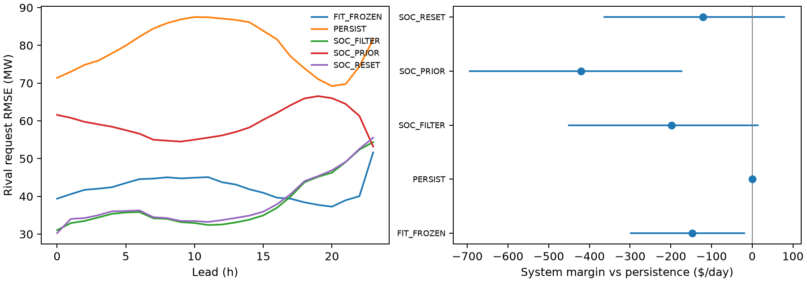

# Stage 2: Hidden Rival SOC Inference

## Setup

All five owners act simultaneously. The farm data, battery parameters, shared
connection, actual-revenue objective and terminal controller match stage 1.
Test dates are April 11–30, 2025. Three declared Monte Carlo seeds are used.
Own generation and prices have perfect foresight; rival generation and SOC are
hidden. Each owner sees only its own requests, accepted exports and past history.

The particle state contains rival SOC, wind deviations, and threshold-policy
indices. Initial SOC is known at the prescribed daily reset. Rival wind uses the
owner's wind capacity factor as a proxy plus bounded AR(1) errors. The wind-error
standard deviation is 0.15; observation-model error is
0.05 times rival nameplate. Each owner has 128
particles. The likelihood uses aggregate request inferred from proportional cuts,
or the upper bound from full acceptance. No rival truth enters filtering.

SOC_PRIOR propagates particles without observation conditioning. SOC_FILTER
conditions on metering and propagates inferred SOC. SOC_RESET applies the same
conditioning but resets rival SOC to 50% each interval, testing the contribution
of retaining a latent energy state. FIT_FROZEN and PERSIST are stage-1 controls.
Filter settings are fixed experiment parameters, not fitted rival telemetry.
Private truth is used only after prediction for scoring.

Particles use a stationary threshold-policy library with 5% interval-wise policy
changes to approximate adaptive opponents. This is a specified inference model;
aggregate observations need not identify individual SOC. Forecast rollouts use
that model rather than private future states. The model includes no reserve
monitor or SOC violations; this study concerns hidden rival storage states.

## Operating and prediction results

System margins are dollars/day, averaged across seeds within each day.
RMSE is computed from individual seed predictions before seed averaging.

| method | system_J | overflow_mwh | rmse_mw |
| --- | --- | --- | --- |
| FIT_FROZEN | 65014.498 | 578.641 | 39.388 |
| PERSIST | 65161.343 | 576.342 | 71.392 |
| SOC_FILTER | 64963.345 | 576.504 | 31.059 |
| SOC_PRIOR | 64740.728 | 586.584 | 61.585 |
| SOC_RESET | 65040.407 | 575.245 | 30.262 |

## Paired system margin relative to persistence

Intervals bootstrap the 20 day blocks after seed averaging. Common seeds are
used across particle treatments. The deterministic controls repeat identically.

| method | delta_system_J | low | high |
| --- | --- | --- | --- |
| FIT_FROZEN | -146.845 | -300.596 | -17.193 |
| PERSIST | 0.000 | 0.000 | 0.000 |
| SOC_FILTER | -197.998 | -451.941 | 15.206 |
| SOC_PRIOR | -420.614 | -695.508 | -171.798 |
| SOC_RESET | -120.936 | -365.663 | 81.148 |

## Filter ablations: paired system margin

| method | reference | delta_system_J | low | high |
| --- | --- | --- | --- | --- |
| SOC_FILTER | SOC_PRIOR | 222.617 | 104.274 | 366.666 |
| SOC_FILTER | SOC_RESET | -77.062 | -163.833 | -2.944 |

## SOC estimation (hours 1–23)

The known initial SOC at hour 0 is excluded. Aggregate RMSE scores the sum of
four rival SOC values; individual RMSE averages the four separate errors.

| method | ess | aggregate_rmse_mwh | individual_rmse_mwh |
| --- | --- | --- | --- |
| SOC_FILTER | 85.047 | 27.304 | 9.390 |
| SOC_PRIOR | 128.000 | 29.215 | 8.869 |
| SOC_RESET | 82.354 | 37.002 | 11.094 |

The PRIOR and RESET controls distinguish observation conditioning from carrying
SOC forward. Results are conditional on the proxy wind and policy library.
Seed-level trajectories, SOC errors, and forecast paths are saved separately.
